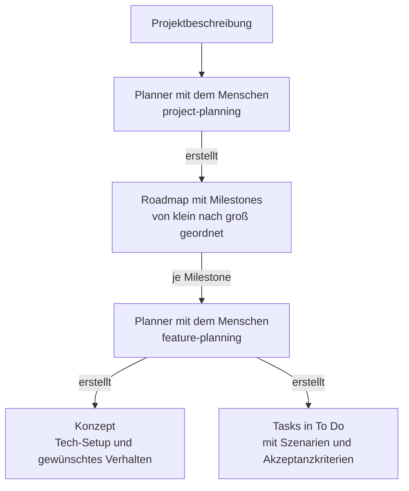
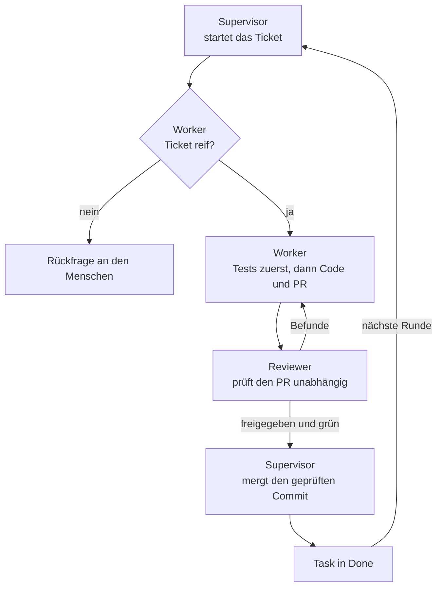

# CCMAS - claude code multi agent setup

CCMAS (Claude Code Multi Agent Setup) lässt KI-Agents mit festen Rollen ein Projekt planen und sein Board Ticket für Ticket abarbeiten: Planner, Supervisor, Worker und Reviewer. Dieses Repository enthält das Verhalten dafür als Plugin für Claude Code. Die Sitzungen führt Claude Code selbst oder ein Runner wie Orchestrator.

**Stand:** Änderungen im [CHANGELOG](CHANGELOG.md). Das Plugin besteht `claude plugin validate`. Das Verhalten von Claude Code und Orchestrator, auf dem es aufbaut, ist ausprobiert ([Claude Code](docs/01-spezifikation/runner.md#geprüft), [Orchestrator](docs/02-orchestrator/README.md#geprüft)). Die Skills dieser Fassung sind in keiner echten Sitzung mit Board erprobt ([Noch nicht geprüft](#noch-nicht-geprüft)).

## So arbeitet CCMAS

Das Plugin beschreibt, was eine Rolle tut. Der Runner bestimmt, wann und wo sie läuft, und stellt ihr Ereignisse zu. Mit Claude Code allein ist der Mensch der Runner.

Die Planung eines Projekts:



Das Abarbeiten eines Tasks:



Die vollständige Beschreibung steht in der [Spezifikation](docs/01-spezifikation/README.md). In Kurzform:

- **Rollen.** Planner, Supervisor, Worker, Reviewer und der Mensch. Eine Rolle ist eine Sitzung, deren erster Auftrag einen Skill aufruft. ([Rollen](docs/01-spezifikation/konzept.md#rollen))
- **Der Stand liegt außerhalb der Sitzungen.** Das Ticket trägt den Auftrag, der PR den Stand der Umsetzung, das Repository Code und `docs/`. Jede Sitzung darf enden. ([Grundsätze](docs/01-spezifikation/konzept.md#grundsätze))
- **Planung in zwei Stufen.** Erst wird das Projekt in Milestones zerlegt, von klein nach groß. Dann wird ein Milestone konzipiert und in Tasks zerlegt, mit Tech-Setup, gewünschtem Verhalten, Szenarien und Akzeptanzkriterien. Der letzte Task ist der Abnahmetest. ([Planung](docs/01-spezifikation/konzept.md#planung))
- **Ein Ticket, eine Sitzung, ein PR.** Der Worker besitzt sein Ticket von To Do bis zum Merge, einschließlich Befunden, roten Prüfungen und Konflikten.
- **Erst klären, dann bauen.** Der Worker prüft zuerst, ob das Ticket reif ist. Fehlt etwas, das nur der Mensch klären kann, entsteht eine Rückfrage, und es wird kein Code geschrieben.
- **Test zuerst.** Aus den Szenarien des Tasks entstehen zuerst die Tests, danach der Code.
- **Unabhängiges Review.** Wer umsetzt, prüft nicht. Das Urteil gilt für genau einen Commit. Nach Befunden in der dritten Runde entscheidet der Mensch.
- **Gemergt wird nur der geprüfte Commit.** Der Supervisor mergt, wenn das Urteil für den aktuellen Commit gilt, die Prüfungen grün sind und eine nötige Freigabe erteilt ist. ([Merge](docs/01-spezifikation/konzept.md#merge))
- **Freigaben in zwei Stufen.** Ein PR braucht eine Freigabe oder keine. Wann und von wem, steht in der `CLAUDE.md` des Projekts; die Vorgabe ist der Mensch. ([Freigaben](docs/01-spezifikation/konzept.md#freigaben))
- **Board.** Fünf Spalten: Backlog, To Do, In Progress, To Review, Done. Der Stand von Review und Prüfungen steht am PR, nicht im Board. ([Board](docs/01-spezifikation/board.md))
- **Rückfragen statt Annahmen.** Was nur der Mensch klären kann, wird erst in der Sitzung gefragt, sonst als Unteraufgabe `Entscheidung:`, `Freigabe:` oder `Zuarbeit:` im Ticket. Keine Antwort ist keine Zustimmung. ([Rückfragen](docs/01-spezifikation/board.md#rückfragen-an-den-menschen))
- **Milestones.** Sind alle Tasks eines Milestones fertig, fordert der Supervisor die Abnahme an und schließt ihn nach der Freigabe.
- **Worktrees.** Jedes Ticket hat einen eigenen Worktree mit eigenem Branch; im Hauptverzeichnis wird nichts geändert.
- **Austauschbar.** Nur der Skill `ticket` kennt das Ticketsystem. Die Skills nennen für alles, was vom Runner abhängt, ein Verb; der Runner bringt seine Zuordnung mit. ([Runner](docs/01-spezifikation/runner.md))

## Aufbau

| Pfad | Inhalt |
| --- | --- |
| `claude-plugin/` | Das Plugin `ccmas`: sieben Skills und ein Agent ([Rollen, Start, Skills](claude-plugin/README.md)) |
| `docs/01-spezifikation/` | Das Konzept: Grundsätze, Rollen, Board, Runner ([Übersicht](docs/01-spezifikation/README.md)) |
| `docs/02-orchestrator/` | CCMAS mit Orchestrator als Runner: [Zuordnung](docs/02-orchestrator/README.md) und [Einrichtung](docs/02-orchestrator/einrichtung.md) |
| `orchestrator/` | Die zwei Regeldateien, die das Plugin mit Orchestrator verbinden |
| `.claude-plugin/marketplace.json` | Macht dieses Repository zur Quelle, aus der Claude Code das Plugin installiert. Die Quelle heißt `alexwenzel` |

Spezifikation und Plugin liegen im selben Repository. Wer das Verhalten ändert, ändert beide im selben PR.

## Voraussetzungen

- Claude Code, angemeldet.
- Die Kommandozeile `gh`, angemeldet.
- In Claude Code eine Verbindung zum Ticketsystem (Asana).
- Im Zielprojekt: ein Git-Repository mit dem Integrationsbranch `develop` und ein Board mit den Spalten Backlog, To Do, In Progress, To Review, Done und den Feldern ID, Typ, Meilenstein, Label und PR ([Board](docs/01-spezifikation/board.md)).
- Alle Rollen schreiben unter dem Konto ins Ticketsystem, mit dem die Verbindung angemeldet ist.

## Plugin aktivieren und deaktivieren

Das Plugin heißt `ccmas`, die Quelle `alexwenzel`. In den Befehlen steht deshalb `ccmas@alexwenzel`.

### Einmalig: die Quelle bekannt machen

```bash
claude plugin marketplace add /Users/alex/Projekte/alexwenzel/ccmas
```

Aus GitHub, als veröffentlichter Stand von `main`: `claude plugin marketplace add alexwenzel/ccmas`. Den Entwicklungsstand oder eine bestimmte Version zeigt [RELEASE.md](RELEASE.md#kanäle).

Bei einem lokalen Pfad liest Claude Code das Plugin direkt aus diesem Ordner. Eine Änderung an den Dateien wirkt in der nächsten Sitzung, ohne neue Installation.

### Wo es gilt

| Geltung                                 | Schalter          | Gespeichert in                                         |
| --------------------------------------- | ----------------- | ------------------------------------------------------ |
| Global: in jedem Verzeichnis            | `--scope user`    | `~/.claude/settings.json`                              |
| Ein Verzeichnis, nur für dich           | `--scope local`   | `.claude/settings.local.json` im Verzeichnis           |
| Ein Verzeichnis, für alle im Repository | `--scope project` | `.claude/settings.json` im Verzeichnis, wird committet |

### Global

```bash
claude plugin install   ccmas@alexwenzel --scope user   # aktivieren
claude plugin disable   ccmas@alexwenzel --scope user   # deaktivieren, bleibt installiert
claude plugin enable    ccmas@alexwenzel --scope user   # wieder aktivieren
claude plugin uninstall ccmas@alexwenzel --scope user   # entfernen
```

### Nur in einem Verzeichnis

Die Befehle im Verzeichnis des Projekts ausführen:

```bash
cd /pfad/zum/projekt
claude plugin install   ccmas@alexwenzel --scope local   # aktivieren
claude plugin disable   ccmas@alexwenzel --scope local   # deaktivieren
claude plugin enable    ccmas@alexwenzel --scope local   # wieder aktivieren
claude plugin uninstall ccmas@alexwenzel --scope local   # entfernen
```

In allen anderen Verzeichnissen bleibt das Plugin aus. Mit `--scope project` statt `--scope local` gilt die Einstellung für alle, die im Repository arbeiten; jeder muss die Quelle dann einmal selbst bekannt machen.

### Global an, in einem Verzeichnis aus

```bash
cd /pfad/zum/projekt
claude plugin disable ccmas@alexwenzel --scope local   # hier aus, überall sonst an
claude plugin enable  ccmas@alexwenzel --scope local   # hier wieder an
```

### Nur für eine Sitzung, ohne Installation

```bash
claude --plugin-dir /Users/alex/Projekte/alexwenzel/ccmas/claude-plugin
```

### Prüfen

```bash
claude plugin list                       # Stand im aktuellen Verzeichnis: Geltung, an oder aus
claude plugin details ccmas@alexwenzel   # Skills, Agents, Kosten im Kontext
claude plugin validate claude-plugin     # Manifest und Dateien prüfen
```

In einer laufenden Sitzung zeigt `/plugin` dasselbe; `/reload-plugins` lädt geänderte Dateien neu. Eine laufende Sitzung merkt ein An- oder Abschalten erst danach oder nach einem Neustart.

Ist das Plugin an, kostet es in jeder Sitzung rund 600 Tokens für die Namen und Beschreibungen. Der volle Text eines Skills oder Agents wird erst geladen, wenn er gebraucht wird.

## Ein Projekt einrichten

Im Hauptverzeichnis des Zielprojekts, auf dem Integrationsbranch:

```bash
claude "/ccmas:init <Name oder Link des Boards>"
```

Der Skill legt `CLAUDE.md`, `docs/` und die Einstellungen für Worktrees und Verbote an, aktiviert das Plugin für das Projekt, trägt die Kennungen von Board, Spalten und Feldern ein und überschreibt nichts. Danach die Dateien prüfen und committen.

### Was im Projekt liegt

`/ccmas:init` legt im Hauptverzeichnis des Projekts an, überschreibt nichts und committet nichts:

| Datei | Inhalt |
| --- | --- |
| `CLAUDE.md` | Die Projektregeln: Referenzen (Ticketsystem, Board, Repository, Integrationsbranch, CI ja oder nein, Mensch für Rückfragen; Spalten und Felder mit ihren Kennungen), Prüfbefehle, Arbeitsweise, Freigaben, der Maßstab für das Review, Grenzen |
| `docs/README.md` | Hülle für die Dokumentation |
| `.gitignore` | Die Zeile `.claude/worktrees/` |
| `.claude/settings.json` | `worktree.baseRef` auf `"head"`, damit Worktrees vom Integrationsbranch abzweigen; das aktivierte Plugin; Verbote für `--force` und für Push auf `main` und den Integrationsbranch |
| `.worktreeinclude` | Von Git ignorierte Dateien, die jeder Worktree braucht, etwa `.env`. Nur wenn der Mensch welche nennt |

Dazu am Repository auf GitHub die Labels `freigabe: nötig` und `freigabe: erteilt`, nach dem Ja des Menschen.

- Voraussetzung sind ein Git-Repository mit dem Integrationsbranch `develop` und ein Board mit den Spalten und Feldern aus [Board](docs/01-spezifikation/board.md). `init` legt weder Repository noch Branch noch Board an.
- Die Kennungen liest `init` aus dem Board. Was es nicht lesen konnte, bleibt `TODO`. Ein Lauf, der eine leere Referenz braucht, ändert nichts und rät nicht.
- Der Mensch prüft die Dateien und committet sie einmal, damit Worktrees sie sehen.

## Rollen starten

Jede Rolle ist ein Aufruf von Claude Code mit einem Skill als erstem Auftrag, zum Beispiel:

```bash
claude --permission-mode bypassPermissions --model opus "/ccmas:supervisor"
```

Der Supervisor mergt, was geprüft ist, und nennt nach jeder Runde die Befehle für die nächsten Tickets. Alle Startbefehle stehen in der [README des Plugins](claude-plugin/README.md#start-einer-rolle).

## Mit einem Runner

Ein Runner startet Claude Code selbst, gibt jedem Ticket einen Worktree und stellt Ereignisse zu. Damit seine Sitzungen das Plugin laden, muss es global aktiviert sein (`--scope user`) oder im Projekt (`--scope project`); `/ccmas:init` aktiviert es im Projekt.

- **Orchestrator:** [Zuordnung](docs/02-orchestrator/README.md) und [Einrichtung](docs/02-orchestrator/einrichtung.md).
- **Herdr:** Noch nicht ausgearbeitet.

## Umstieg von 0.4.0

Diese Fassung bricht mit 0.4.0. In einem Projekt, das schon mit CCMAS arbeitet:

- **Aufrufe.** `/ccmas:feature-parallel` heißt `/ccmas:worker`, `/ccmas:code-review` heißt `/ccmas:reviewer`. `/ccmas:task-planning` und `/ccmas:merge` gibt es nicht mehr: Die Reife prüft der Worker, den Merge gibt der Supervisor. Die Rollen starten ohne `--agent`.
- **Board.** Die Spalte To Plan und die Felder Risikoklasse, Am Zug, Ausgang und Review-Runde werden nicht mehr gelesen und können entfallen. Tickets aus To Plan gehören nach To Do, wenn sie ausgeplant sind, sonst in den Backlog.
- **`CLAUDE.md` des Projekts.** Die Abschnitte „Freigaben“ und „Review“ aus der [Vorlage](claude-plugin/skills/init/CLAUDE.vorlage.md) übernehmen und die Tabellen unter „Referenzen“ um die entfallenen Zeilen kürzen. `/ccmas:init` überschreibt die Datei nicht, nennt aber die fehlenden Abschnitte.
- **Einstellungen und Labels.** `/ccmas:init` erneut ausführen: Es ergänzt die Verbote in `.claude/settings.json` und legt die Labels `freigabe: nötig` und `freigabe: erteilt` an.
- **Orchestrator.** Beide Regeldateien unter `orchestrator/` durch die neuen ersetzen und den Orchestrator des Projekts neu starten ([Einrichtung](docs/02-orchestrator/einrichtung.md)).

## Noch nicht geprüft

- Die Skills dieser Fassung in einer echten Sitzung mit Board: `worker`, `reviewer`, `supervisor`, `project-planning`, `feature-planning`, `init` und `ticket`. Läufe gab es mit der Fassung 0.4.0; die Abläufe dieser Fassung sind neu.
- Der Skill `reviewer` als abgezweigter Subagent des Workers: dass er im Worktree des Workers auf dem Stand des PR läuft, das Ticket über `ccmas:ticket` lesen kann und sein Urteil beim Worker ankommt. Geprüft ist der Mechanismus mit einem Probe-Skill ([Geprüft](docs/01-spezifikation/runner.md#geprüft)).
- Ob der Worker bei offenen Fragen zur Reife keinen Code schreibt und ob er bis zum Merge an seinem Ticket bleibt.
- Ob der Supervisor eine laufende Sitzung an der PID im Sperrvermerk des Worktrees erkennt.
- Die Verbote unter `permissions.deny`, die `/ccmas:init` einträgt. Sie sind nach der Dokumentation von Claude Code geschrieben.
- Ob der Skill `init` seine Vorlagen im Ordner des Plugins findet.
- Das Zusammenspiel mit Orchestrator in dieser Fassung ([Noch offen](docs/02-orchestrator/README.md#noch-offen)) und mit Herdr.
- Der Skill `/release`: Die Veröffentlichung von 0.4.0 lief nach dem Ablauf in [RELEASE.md](RELEASE.md), und die Prüfung für PRs nach `main` lief dabei grün. Ob der Skill selbst jeden Schritt trägt, ist nicht festgehalten.

Was noch nicht entschieden ist, steht in der [Spezifikation](docs/01-spezifikation/offene-punkte.md).

## Pflege

- Dieses Repository ist die einzige Stelle, an der Plugin und Spezifikation gepflegt werden. Die Version der Dokumente ergibt sich aus Git.
- Jede inhaltliche Änderung am Plugin oder an der Spezifikation steht im [CHANGELOG](CHANGELOG.md) unter „Unveröffentlicht“. Die `version` in `claude-plugin/.claude-plugin/plugin.json` erhöht nur ein Release ([Release und Versionierung](RELEASE.md)).
- Vor einem Commit: `claude plugin validate claude-plugin`, `claude plugin validate .` und `python3 -I scripts/links-pruefen.py`. Dieselben Prüfungen laufen in der CI.
