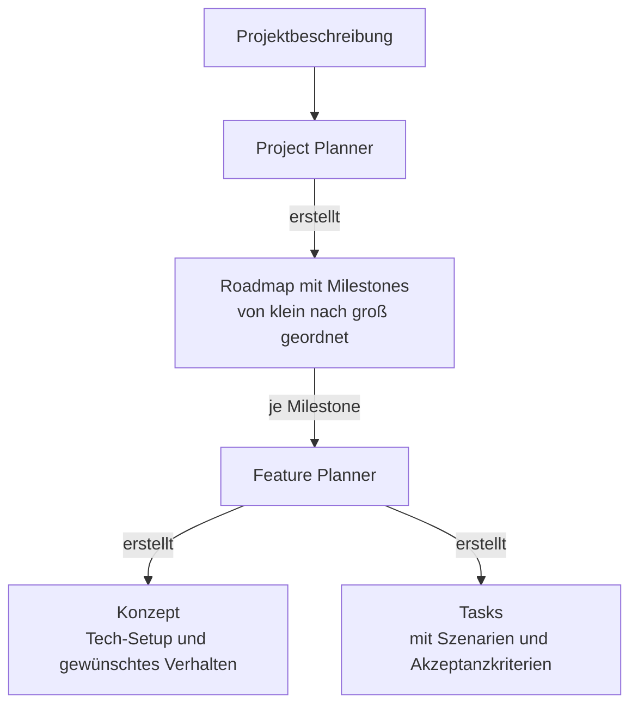
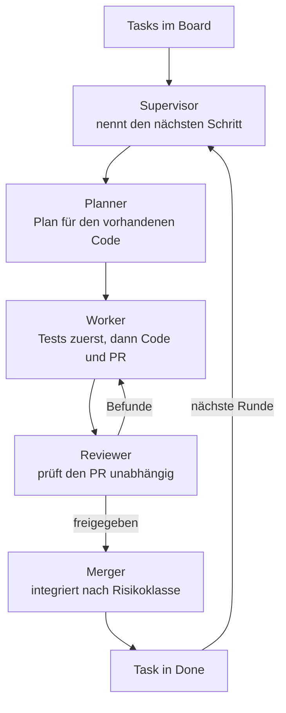

# CCMAS - claude code multi agent setup

CCMAS (Claude Code Multi Agent Setup) lässt KI-Agents mit festen Rollen ein Projekt planen und sein Board Ticket für Ticket abarbeiten: Project Planner, Feature Planner, Supervisor, Planner, Worker, Reviewer und Merger. Dieses Repository enthält das Verhalten dafür als Plugin für Claude Code und andere Tools. Die Sitzungen führt Claude Code selbst oder ein Runner wie Orchestrator.

**Stand:** Plugin 0.3.0. Manifest, Installation und alle Befehle im Abschnitt „Plugin aktivieren und deaktivieren“ sind mit Claude Code 2.1.325 geprüft. Die Fassung 0.3.0 ist noch nicht mit `claude plugin validate` geprüft und in keiner echten Sitzung mit Board erprobt.

## So arbeitet CCMAS

Die Planung eines Projekts:



Das Abarbeiten eines Tasks:



Die vollständige Beschreibung steht in der [Spezifikation](docs/01-spezifikation/README.md). In Kurzform:

- **Rollen.** Sieben Agents und der Mensch. Jede Rolle ist eine eigene Sitzung mit frischem Kontext und genau einem Auftrag: ein Ticket, ein Schritt. Keine Rolle startet eine andere. ([Rollen](docs/01-spezifikation/rollen.md))
- **Der Stand liegt außerhalb der Agents.** Ticket, Repository und PR sind die einzige Übergabe. Jede Sitzung darf jederzeit enden. ([Grundsätze](docs/01-spezifikation/konzept.md#grundsätze))
- **Planung in drei Stufen.** Der Project Planner zerlegt ein Projekt in Milestones, von klein nach groß: erst Grundlagen, dann einzelne Units, dann deren Zusammenführung. Der Feature Planner konzipiert einen Milestone, legt Tech-Setup und gewünschtes Verhalten fest und zerlegt ihn in Tasks. Der Planner plant einen Task für den vorhandenen Code aus. Entscheidungen fließen nur nach unten. ([Planung](docs/01-spezifikation/planung.md))
- **Technik steht fest, bevor ein Worker beginnt.** Jeder Task enthält gewünschtes Verhalten, technische Vorgaben, Szenarien und Akzeptanzkriterien. Die Akzeptanzkriterien schreibt der Feature Planner, nicht die Rolle, die umsetzt.
- **Test zuerst.** Der Worker macht aus den Szenarien des Tasks zuerst die Tests und schreibt danach den Code. Ein Task ist eine isolierte Logik.
- **Board.** Sechs Spalten: Backlog, To Plan, To Do, In Progress, To Review, Done. Die Felder „Am Zug“ und „Ausgang“ sagen, wer als Nächstes handelt und wie der letzte Schritt endete. ([Board](docs/01-spezifikation/board.md))
- **Übergaben in fester Form.** Jede Rolle beendet ihre Arbeit mit Spalte, Feldern und einem Kommentar mit festem Aufbau. Die nächste Rolle prüft zuerst ihre Voraussetzungen; stimmt etwas nicht, ändert sie nichts. ([Übergaben](docs/01-spezifikation/board.md#übergaben))
- **Supervisor-Loop.** Der Supervisor holt den aktuellen Stand, bereinigt das Board und nennt genau einen nächsten Schritt aus Rolle und Ticket. Integrieren geht vor Neuem. ([Ablauf](docs/01-spezifikation/ablauf.md))
- **Unabhängiges Review.** Wer umsetzt, prüft nicht. Der Reviewer prüft nur lesend, führt die Prüfbefehle selbst aus, und sein Urteil gilt für genau einen Commit. Nach drei Runden mit Befunden entscheidet der Mensch.
- **Merge nach Risikoklasse.** R0 bis R2 integriert der Merger nach bestandenem Review selbst, R3 erst nach Freigabe durch den Menschen. ([Risikoklassen](docs/01-spezifikation/rollen.md#risikoklassen))
- **Rückfragen statt Annahmen.** Was nur der Mensch klären kann, wird erst in der Sitzung gefragt, sonst als Unteraufgabe `Entscheidung:`, `Freigabe:` oder `Zuarbeit:` im Ticket. Keine Antwort ist keine Zustimmung. ([Rückfragen](docs/01-spezifikation/board.md#rückfragen-an-den-menschen))
- **Milestones.** Sind alle Tasks eines Milestones fertig, fordert der Supervisor die Abnahme an und schließt ihn nach der Freigabe.
- **Worktrees.** Jedes Ticket hat einen eigenen Worktree mit eigenem Branch; im Hauptverzeichnis wird nichts geändert. Nach dem Merge entfernt der Supervisor Worktree und Branch.
- **Dokumentation im Repository.** Roadmap und Konzepte liegen unter `docs/` des Projekts und entstehen als Doku-PR, der wie Code durch Review und Merge läuft.
- **Ein Konto.** Alle Rollen schreiben unter dem Konto ins Ticketsystem, mit dem die Verbindung angemeldet ist. Welche Rolle geschrieben hat, steht in der ersten Zeile des Kommentars.
- **Austauschbar.** Nur der Skill `ticket` kennt das Ticketsystem. Die Rollen hängen nicht daran, wer ihre Sitzungen startet.

## Aufbau

| Pfad                              | Inhalt                                                                                                                              |
| --------------------------------- | ----------------------------------------------------------------------------------------------------------------------------------- |
| `claude-plugin/`                  | Das Plugin `ccmas`: sieben Agents, neun Skills ([Rollen, Start, Skills](claude-plugin/README.md))                                   |
| `docs/01-spezifikation/`          | Das Konzept, aufgeteilt in sieben Dateien ([Übersicht](docs/01-spezifikation/README.md))                                            |
| `docs/02-orchestrator/`           | CCMAS mit Orchestrator als Runner: [Konzept](docs/02-orchestrator/README.md) und [Einrichtung](docs/02-orchestrator/einrichtung.md) |
| `orchestrator/`                   | Die zwei Regeldateien, die das Plugin mit Orchestrator verbinden                                                                    |
| `.claude-plugin/marketplace.json` | Macht dieses Repository zur Quelle, aus der Claude Code das Plugin installiert. Die Quelle heißt `alexwenzel`                       |

Spezifikation und Plugin liegen im selben Repository. Wer das Verhalten ändert, ändert beide im selben PR.

## Voraussetzungen

- Claude Code, angemeldet.
- Die Kommandozeile `gh`, angemeldet.
- In Claude Code eine Verbindung zum Ticketsystem (Asana).
- Im Zielprojekt: ein Git-Repository mit dem Integrationsbranch `develop` und ein Board mit den Spalten Backlog, To Plan, To Do, In Progress, To Review, Done und den Feldern aus der Spezifikation.
- Alle Rollen schreiben unter dem Konto ins Ticketsystem, mit dem die Verbindung angemeldet ist.

## Plugin aktivieren und deaktivieren

Das Plugin heißt `ccmas`, die Quelle `alexwenzel`. In den Befehlen steht deshalb `ccmas@alexwenzel`.

### Einmalig: die Quelle bekannt machen

```bash
claude plugin marketplace add /Users/alex/Projekte/alexwenzel/ccmas
```

Bei einem lokalen Pfad liest Claude Code das Plugin direkt aus diesem Ordner. Eine Änderung an den Dateien wirkt in der nächsten Sitzung, ohne neue Installation.

### Wo es gilt

| Geltung                                 | Schalter          | Gespeichert in                                         |
| --------------------------------------- | ----------------- | ------------------------------------------------------ |
| Global: in jedem Verzeichnis            | `--scope user`    | `~/.claude/settings.json`                              |
| Ein Verzeichnis, nur für dich           | `--scope local`   | `.claude/settings.local.json` im Verzeichnis           |
| Ein Verzeichnis, für alle im Repository | `--scope project` | `.claude/settings.json` im Verzeichnis, wird committet |

### Global

```bash
claude plugin install   ccmas@alexwenzel --scope user   # aktivieren
claude plugin disable   ccmas@alexwenzel --scope user   # deaktivieren, bleibt installiert
claude plugin enable    ccmas@alexwenzel --scope user   # wieder aktivieren
claude plugin uninstall ccmas@alexwenzel --scope user   # entfernen
```

### Nur in einem Verzeichnis

Die Befehle im Verzeichnis des Projekts ausführen:

```bash
cd /pfad/zum/projekt
claude plugin install   ccmas@alexwenzel --scope local   # aktivieren
claude plugin disable   ccmas@alexwenzel --scope local   # deaktivieren
claude plugin enable    ccmas@alexwenzel --scope local   # wieder aktivieren
claude plugin uninstall ccmas@alexwenzel --scope local   # entfernen
```

In allen anderen Verzeichnissen bleibt das Plugin aus. Mit `--scope project` statt `--scope local` gilt die Einstellung für alle, die im Repository arbeiten; jeder muss die Quelle dann einmal selbst bekannt machen.

### Global an, in einem Verzeichnis aus

```bash
cd /pfad/zum/projekt
claude plugin disable ccmas@alexwenzel --scope local   # hier aus, überall sonst an
claude plugin enable  ccmas@alexwenzel --scope local   # hier wieder an
```

### Nur für eine Sitzung, ohne Installation

```bash
claude --plugin-dir /Users/alex/Projekte/alexwenzel/ccmas/claude-plugin
```

### Prüfen

```bash
claude plugin list                       # Stand im aktuellen Verzeichnis: Geltung, an oder aus
claude plugin details ccmas@alexwenzel   # Skills, Agents, Kosten im Kontext
claude plugin validate claude-plugin     # Manifest und Dateien prüfen
```

In einer laufenden Sitzung zeigt `/plugin` dasselbe; `/reload-plugins` lädt geänderte Dateien neu. Eine laufende Sitzung merkt ein An- oder Abschalten erst danach oder nach einem Neustart.

Ist das Plugin an, kostet es in jeder Sitzung rund 600 Tokens für die Namen und Beschreibungen. Der volle Text eines Skills oder Agents wird erst geladen, wenn er gebraucht wird.

## Ein Projekt einrichten

Im Hauptverzeichnis des Zielprojekts, auf dem Integrationsbranch:

```bash
claude "/ccmas:init <Name oder Link des Boards>"
```

Der Skill legt `CLAUDE.md`, `docs/` und die Einstellungen für Worktrees an, aktiviert das Plugin für das Projekt, trägt die Kennungen von Board, Spalten und Feldern ein und überschreibt nichts. Danach die Dateien prüfen und committen.

### Was im Projekt liegt

`/ccmas:init` legt im Hauptverzeichnis des Projekts an, überschreibt nichts und committet nichts:

| Datei                   | Inhalt                                                                                                                                                                                                  |
| ----------------------- | ------------------------------------------------------------------------------------------------------------------------------------------------------------------------------------------------------- |
| `CLAUDE.md`             | Die Projektregeln: Referenzen (Ticketsystem, Board, Repository, Integrationsbranch, CI ja oder nein, Mensch für Rückfragen; Spalten und Felder mit ihren Kennungen), Prüfbefehle, Arbeitsweise, Grenzen |
| `docs/README.md`        | Hülle für die Dokumentation                                                                                                                                                                             |
| `.gitignore`            | Die Zeile `.claude/worktrees/`                                                                                                                                                                          |
| `.claude/settings.json` | `worktree.baseRef` auf `"head"`, damit Worktrees vom Integrationsbranch abzweigen, CCMAS Plugin aktivierung                                                                                             |

- Voraussetzung sind ein Git-Repository mit dem Integrationsbranch `develop` und ein Board mit den Spalten und Feldern aus [Projektboard](docs/01-spezifikation/board.md#projektboard). `init` legt weder Repository noch Branch noch Board an.
- Die Kennungen liest `init` aus dem Board. Was es nicht lesen konnte, bleibt `TODO`. Ein Lauf, der eine leere Referenz braucht, bricht ab und rät nicht.
- Der Mensch prüft die Dateien und committet sie einmal, damit Worktrees sie sehen.

## Rollen starten

Jede Rolle ist ein Aufruf von Claude Code mit Agent und Skill, zum Beispiel:

```bash
claude --permission-mode bypassPermissions --agent ccmas:supervisor "/ccmas:supervisor"
```

Der Supervisor nennt nach jeder Runde den nächsten Schritt als Rolle und Ticket. Alle Startbefehle stehen in der [README des Plugins](claude-plugin/README.md#start-einer-rolle).

## Mit einem Runner

Ein Runner startet Claude Code selbst. Damit seine Sitzungen das Plugin laden, muss es global aktiviert sein (`--scope user`) oder im Projekt (`--scope project`); `/ccmas:init` aktiviert es im Projekt.

- **Orchestrator:** [Konzept](docs/02-orchestrator/README.md) und [Einrichtung](docs/02-orchestrator/einrichtung.md). Die Regeldateien unter `orchestrator/` kennen die Rollen Project Planner und Feature Planner noch nicht.
- **Herdr:** Noch nicht ausgearbeitet.

## Noch nicht geprüft

- Start mit `--agent ccmas:<rolle>` und einem Skill-Aufruf als erstem Auftrag.
- Ob der Text eines Agents als Hauptsitzung ausreicht; er ersetzt dort den Standard-Systemprompt von Claude Code.
- Ob der Skill `init` seine Vorlagen im Ordner des Plugins findet.
- Lesen und Schreiben im Ticketsystem aus den Skills.
- Das Zusammenspiel mit Orchestrator (Regeldateien unter `orchestrator/`) und mit Herdr.

Weitere offene Punkte stehen in der [Spezifikation](docs/01-spezifikation/offene-punkte.md).

## Pflege

- Dieses Repository ist die einzige Stelle, an der Plugin und Spezifikation gepflegt werden. Die Version der Dokumente ergibt sich aus Git.
- Bei jeder inhaltlichen Änderung am Plugin die `version` in `claude-plugin/.claude-plugin/plugin.json` erhöhen.
- Vor einem Commit: `claude plugin validate claude-plugin` und `claude plugin validate .`.
