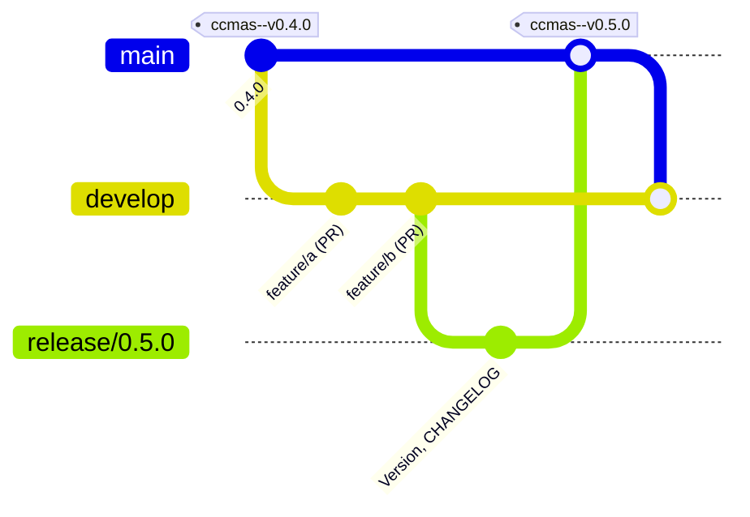

# Release und Versionierung

Wie CCMAS veröffentlicht wird. Gilt für dieses Repository, nicht für Zielprojekte.

## Grundsätze

- **Eine Version für Plugin und Spezifikation.** Maßgeblich ist `version` in [`claude-plugin/.claude-plugin/plugin.json`](claude-plugin/.claude-plugin/plugin.json). Dokumente tragen keine eigene Version.
- **Die Version steigt nur im Release.** Feature-PRs fassen sie nicht an, sonst gibt es Konflikte zwischen parallelen PRs und Versionen ohne Release. Sie tragen ihre Änderung im [CHANGELOG](CHANGELOG.md) unter „Unveröffentlicht“ ein.
- **`main` ist der veröffentlichte Stand.** Auf `main` landet nur ein Release oder ein Hotfix, jeweils über einen PR. Jeder Stand auf `main` hat ein Tag und ein GitHub-Release.
- **Nutzer bekommen eine neue Fassung nur, wenn sich `version` ändert.** Eine installierte Fassung bleibt sonst auf dem alten Stand, auch wenn `main` weiterläuft ([Claude Code: Keep users up to date](https://code.claude.com/docs/en/plugins/host-marketplace.md#keep-users-up-to-date)).

## Versionsnummer

Semantic Versioning, solange das Plugin unter 1.0.0 ist:

| Änderung | Stelle | Beispiel |
| --- | --- | --- |
| Neue oder geänderte Rolle, neuer oder geänderter Skill, anderer Ablauf, Bruch mit bisherigem Verhalten | MINOR | 0.3.0 → 0.4.0 |
| Korrektur, Klarstellung, Text ohne Änderung des Verhaltens | PATCH | 0.4.0 → 0.4.1 |

Die Version 1.0.0 folgt, wenn der Abschnitt „Noch nicht geprüft“ in der [README](README.md#noch-nicht-geprüft) leer ist. Ab dann steigt MAJOR bei jedem Bruch und MINOR bei neuem Verhalten ohne Bruch.

Änderungen nur an `docs/02-orchestrator/` und `orchestrator/` sind kein Plugin-Verhalten. Sie stehen im CHANGELOG, brauchen aber für sich allein kein Release.

## Ablauf

### Während der Entwicklung

1. Ein Branch von `develop`, ein PR zurück nach `develop`.
2. Wer Plugin oder Spezifikation ändert, ergänzt `CHANGELOG.md` unter `## [Unveröffentlicht]` um eine Zeile in `Hinzugefügt`, `Geändert`, `Behoben` oder `Entfernt`.
3. Die `version` bleibt unverändert.

### Release

Der Skill `/release` im Repository führt durch diese Schritte und fragt vor jedem Schritt nach außen:

1. Branch `release/X.Y.Z` von `develop`.
2. `version` in `plugin.json` auf `X.Y.Z` setzen.
3. In `CHANGELOG.md` `## [Unveröffentlicht]` zu `## [X.Y.Z] – JJJJ-MM-TT` machen und darüber einen neuen, leeren Abschnitt „Unveröffentlicht“ anlegen. Die Links am Ende nachziehen.
4. `claude plugin validate claude-plugin` und `claude plugin validate .`, dazu die Linkprüfung `scripts/links-pruefen.py`.
5. PR `release/X.Y.Z` → `main`. Die CI prüft zusätzlich, dass Version und CHANGELOG zusammenpassen.
6. Merge mit Merge-Commit, kein Squash, damit die Historie von `develop` auf `main` erhalten bleibt.
7. Tag `ccmas--vX.Y.Z` auf dem Merge-Commit auf `main`, dazu `gh release create` mit dem Abschnitt aus dem CHANGELOG.
8. PR `main` → `develop`, damit Version und CHANGELOG dort ankommen.

Der Tag hat die Form `<plugin>--v<version>`, wie Claude Code sie für Versionen auflöst ([Plugin dependencies](https://code.claude.com/docs/en/plugins/dependencies.md#tag-plugin-releases-for-version-resolution)).

### Hotfix

Ein Fehler in einer veröffentlichten Fassung, der nicht auf den nächsten Release warten kann:

1. Branch `hotfix/X.Y.Z` von `main`, nur die Korrektur.
2. Version (PATCH) und CHANGELOG wie im Release.
3. PR nach `main`, Tag und GitHub-Release wie im Release.
4. PR `main` → `develop`.

## Kanäle

Der Standardbranch auf GitHub ist `main`. Wer das Plugin installiert, bekommt deshalb den veröffentlichten Stand.

| Kanal | Quelle hinzufügen | Wann |
| --- | --- | --- |
| Stabil | `claude plugin marketplace add alexwenzel/ccmas` | Normalfall |
| Entwicklung | `claude plugin marketplace add alexwenzel/ccmas#develop` | Neues ausprobieren, noch ohne Release |
| Eine Version | `claude plugin marketplace add alexwenzel/ccmas#ccmas--vX.Y.Z` | Auf einem Stand bleiben |
| Lokal | `claude plugin marketplace add <Pfad zum Klon>` | Selbst am Plugin arbeiten; Änderungen wirken in der nächsten Sitzung, unabhängig von `version` |

Der Marketplace heißt in allen Fällen `alexwenzel`; zwei Kanäle gleichzeitig gehen nicht. Wer wechseln will, entfernt die Quelle zuerst mit `claude plugin marketplace remove alexwenzel`.

## Wenn etwas schiefgeht

- **Falsche Version veröffentlicht:** Keinen Tag verschieben und nichts auf `main` zurückdrehen. Ein Hotfix mit der nächsten PATCH-Version korrigiert es.
- **Tag auf dem falschen Commit, noch von niemandem genutzt:** Tag und GitHub-Release löschen und neu setzen. Das nur nach Rückfrage beim Eigentümer.
