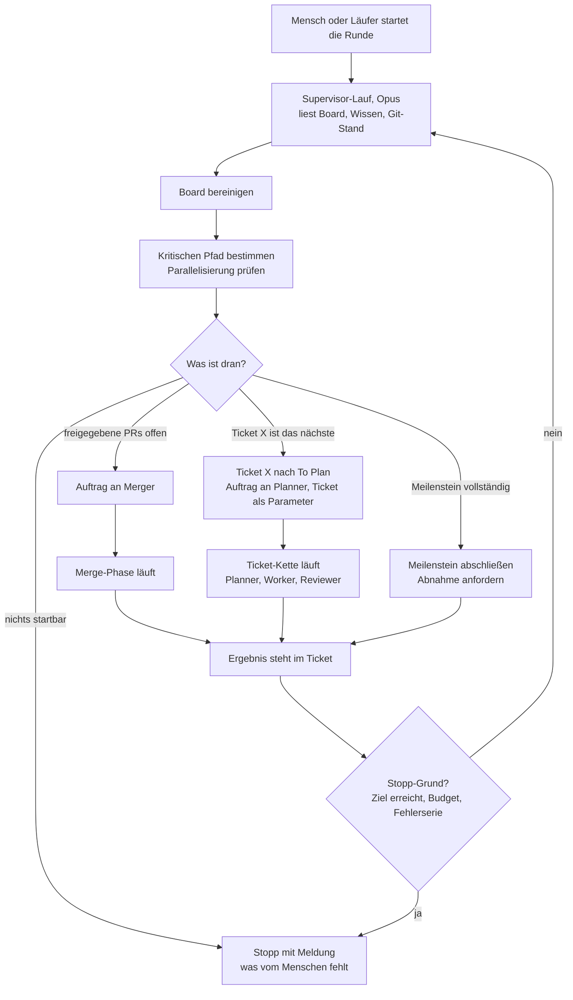
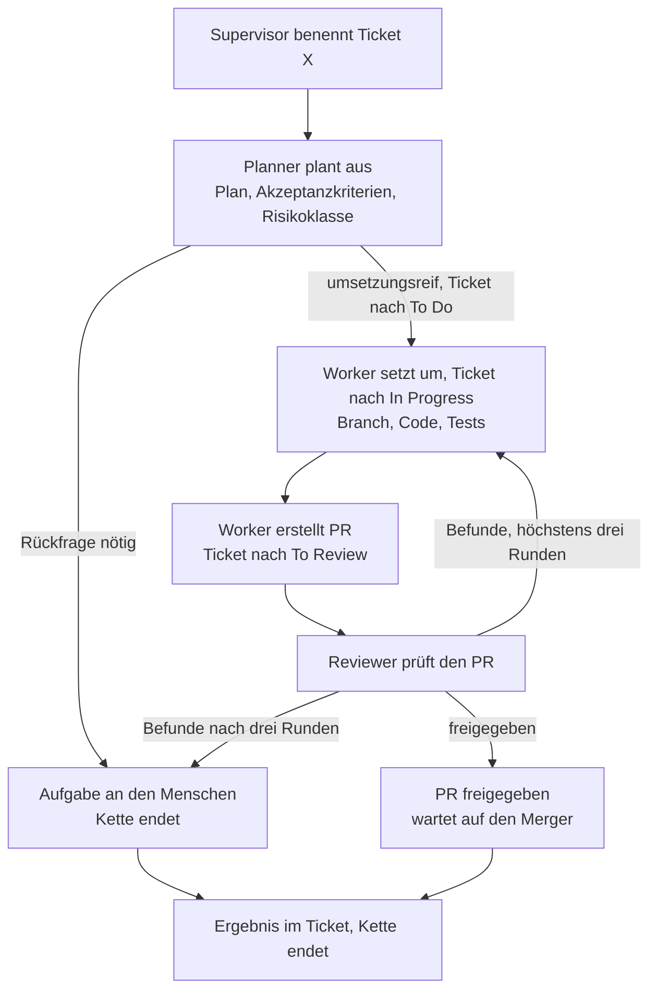
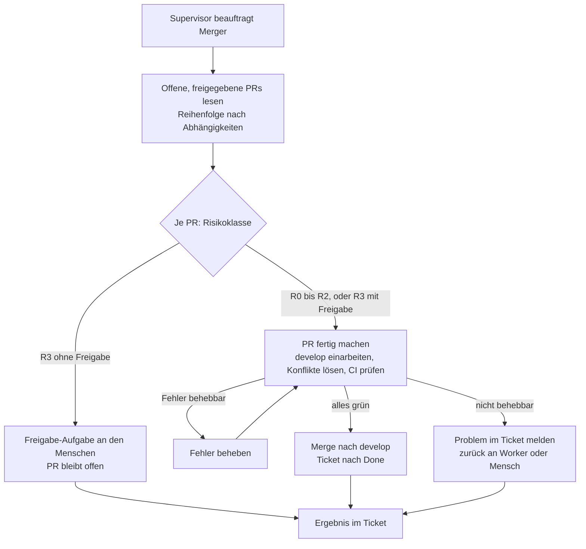

# Ablauf

Der Ablauf nach der [Planung](planung.md): Der Supervisor bestimmt den nächsten Schritt, die Ticket-Kette setzt ein Ticket um, die Merge-Phase integriert es.

## Supervisor-Loop

Eine Runde der Schleife hat vier Teile:

1. **Lesen.** Zuerst holt der Supervisor im Hauptverzeichnis den aktuellen Stand des Integrationsbranch, damit neue Worktrees davon abzweigen. Dann liest er alle offenen Tickets des Boards mit Ticketart, Spalte, Feldern, Abhängigkeiten und offenen Rückfragen, dazu die offenen und zuletzt gemergten PRs und die vorhandenen Worktrees. Er liest keinen Code und keine Verläufe anderer Sitzungen.
2. **Board bereinigen.** Er ändert nur, was eindeutig belegt ist, und nennt jede Änderung:
   - Der PR eines Tickets ist gemergt, das Ticket liegt nicht in Done: nach Done verschieben und schließen.
   - Eine Rückfrage an den Menschen ist erledigt: „Am Zug“ geht zurück an die Rolle, die gefragt hat; die Antwort steht danach als Kommentar im Ticket.
   - Ein Ticket hängt von einem Ticket ab, das jetzt in Done liegt: Es gilt als entsperrt.
   - Alle Tasks eines Milestones liegen in Done: Abnahme anfordern; nach der Freigabe den Milestone schließen ([Supervisor und Milestones](planung.md#supervisor-und-milestones)).
   - Der PR eines Tickets ist gemergt, und das Ticket liegt in Done: Worktree und Branch entfernen (siehe „Worktrees aufräumen“ unten).

   Was widersprüchlich aussieht, ändert er nicht, sondern führt es unter „Unklar“ auf.

3. **Nächsten Schritt bestimmen.** Ein Schritt besteht aus Rolle und Ticket. Es gilt die erste Zeile, die auf ein Ticket zutrifft:

   | Stand des Tickets | Nächster Schritt |
   | --- | --- |
   | To Review, „Am Zug“ Merger | Merger |
   | To Review, „Am Zug“ Reviewer | Reviewer |
   | To Review oder In Progress, „Am Zug“ Worker | Worker |
   | To Do, alle Abhängigkeiten in Done | Worker |
   | Beliebige Spalte, „Am Zug“ Planner | Planner |
   | To Plan | Planner |
   | Backlog, als Nächstes auf dem Weg | Ticket nach To Plan, dann Planner |
   | Kein Task trifft zu, und der nächste Milestone hat keine Tasks | Feature Planner |

   Die Reihenfolge der Zeilen ist der Grundsatz „Integrieren geht vor Neuem“: Erst wird Begonnenes fertig, dann beginnt Neues. Treffen in einer Zeile mehrere Tickets zu, gewinnt das Ticket, das die meisten anderen entsperrt; danach das im früheren Meilenstein, danach das ältere. Übersprungen wird ein Ticket, wenn „Am Zug“ auf Mensch steht, wenn es ein Label trägt oder wenn es von etwas Offenem abhängt.

4. **Melden.** Die Ausgabe hat eine feste Form: Stand, Bereinigt, Unklar, Nächster Schritt, Begründung, Parallel möglich, Wartet auf dich. Unter „Parallel möglich“ stehen höchstens zwei weitere Schritte: Tickets ohne Abhängigkeit untereinander, die nach ihrem Plan verschiedene Dateien berühren. Gibt es keinen startbaren Schritt, steht dort „keiner“ und was fehlt.

Dazu gilt:

- Der Supervisor entscheidet nur, **was** als Nächstes drankommt und **warum**. Beispiel: „Ticket X entsperrt drei weitere Tickets, deshalb plant der Planner als Nächstes Ticket X aus.“
- Das Ticket wird als Parameter übergeben. Die gestartete Rolle bekommt keine Vorgeschichte, nur die Ticket-ID. Alles Weitere liest sie aus dem Ticket.
- Der Supervisor setzt nicht nur neue Tickets in Gang. Er nimmt auch unterbrochene Ketten wieder auf: ein Ticket, das auf den Reviewer wartet, oder eines, das mit Befunden beim Worker liegt.
- Jede Runde beginnt mit dem Stand aus Board und Git, nicht mit dem Gedächtnis der letzten Runde. Deshalb kann jede Runde eine frische Sitzung sein.

**Mit Claude Code allein:** Eine Supervisor-Sitzung ist genau eine Runde. Der Supervisor nennt einen Schritt, der Mensch startet ihn ([Start einer Rolle](../../claude-plugin/README.md#start-einer-rolle)) und danach die nächste Runde. Die Schleife im Diagramm schließt der Mensch.

**Mit einem Runner:** Der Runner schließt die Schleife: Er startet den genannten Schritt und danach die nächste Runde.

**Worktrees aufräumen:** Das macht der Supervisor, weil er als Letzter am Ticket ist und im Hauptverzeichnis steht; eine Sitzung im Worktree kann ihren eigenen Worktree nicht entfernen. Er entfernt einen Worktree nur, wenn sein Branch zu einem gemergten PR gehört, das Ticket in Done liegt, der Worktree keine ungesicherten Dateien hat und nicht von einer laufenden Sitzung gesperrt ist. Dann entfernt er Worktree, lokalen Branch und den Branch im Repository, nie mit `--force`. Alles andere bleibt stehen und steht unter „Unklar“.

**Noch nicht im Plugin:** Die Stopp-Gründe Budget und Fehlerserie aus dem Diagramm zählt noch niemand; die Schleife endet bisher, wenn kein Schritt startbar ist oder der Mensch sie beendet.

## Ticket-Loop

Jeder Schritt der Kette ist eine eigene Sitzung mit eigener Rolle: Planner, Worker, Reviewer. Der Stand wandert über das Ticket von einer Sitzung zur nächsten. Den nächsten Schritt startet der Mensch oder der Runner; keine Rolle startet ihre Nachfolgerin selbst. Liegt das Ticket schon in To Do, beginnt die Kette beim Worker.

1. **Supervisor → Planner.** Der Supervisor benennt Ticket X und schiebt es nach To Plan ([Projektboard](board.md#projektboard)).
2. **Planner.** Kommt der Task vom Feature Planner, stehen gewünschtes Verhalten, technische Vorgaben, Szenarien und Akzeptanzkriterien schon darin; der Planner übernimmt sie unverändert und schreibt nur den Plan für diesen Code, Tests zuerst. Bekommt er statt einer Ticket-ID eine Beschreibung, legt er zuerst das Ticket an; der Text des Menschen bleibt unverändert darin stehen. Dann liest er Ticket, Projektregeln, `docs/` und die betroffenen Stellen im Code und prüft die Reife an vier Fragen: Was soll danach anders sein? Woran erkennt ein Dritter, dass es fertig ist? Welche Dateien und Schnittstellen sind betroffen? Gibt es eine fachliche Wahl, die der Mensch treffen muss?
   - Bleibt eine Frage offen, geht eine Rückfrage an den Menschen, und die Kette endet. Der Planner plant nicht auf Grundlage einer Annahme.
   - Ist das Ticket zu groß (mehr als etwa ein Tag Arbeit oder mehrere unabhängige Dinge), plant er nur den ersten in sich geschlossenen Teil und legt den Rest als Folgetickets im Backlog an.
   - Sonst schreibt er den „Plan“ in die Beschreibung, bei einem Ticket ohne Vorarbeit des Feature Planners auch „Szenarien“ und „Akzeptanzkriterien“, setzt oder prüft die [Risikoklasse](rollen.md#risikoklassen) und schiebt das Ticket nach To Do. Jedes Akzeptanzkriterium ist einzeln prüfbar: ein Befehl, ein Test oder eine beobachtbare Ausgabe.
3. **Worker.** Er prüft, dass Plan, Szenarien, Akzeptanzkriterien und Risikoklasse vorliegen und dass er in einem eigenen Worktree auf einem eigenen Branch steht. Dann schiebt er das Ticket nach In Progress. Er schreibt zuerst zu jedem Szenario einen Test und sieht ihn scheitern, setzt dann den Plan Schritt für Schritt um, bis die Tests bestehen, passt `docs/` an und lässt die Prüfbefehle laufen, bis alle bestehen. Er committet mit der Ticket-ID, pusht, erstellt den PR auf den Integrationsbranch, trägt ihn ins Feld PR ein und schiebt das Ticket nach To Review.
   - Ist der Plan nicht umsetzbar oder widersprüchlich, plant er nicht um. Er sichert das Geänderte und gibt das Ticket mit dem Ausgang „Problem“ an den Planner zurück. Dieser Rückweg ist im Diagramm nicht gezeichnet.
4. **Reviewer.** Er kennt nur das Ticket, den Diff und das Repository, nicht den Weg dorthin. Er stellt sicher, dass der Worktree genau den Stand des PR zeigt, führt die Prüfbefehle selbst aus und prüft jedes Akzeptanzkriterium einzeln mit Beleg. Dazu sechs Fragen: Hat jedes Szenario einen Test? Prüfen die Tests das Verhalten? Hält der Diff die technischen Vorgaben ein? Enthält der Diff Fremdes? Stimmt `docs/` mit dem Code überein? Passt die Risikoklasse zum Diff? Das Urteil lautet FREIGEGEBEN oder BEFUNDE und gilt für den geprüften Commit. Er schreibt es ins Ticket und an den PR und erhöht die Review-Runde. Die Spalte bleibt To Review.
5. **Befunde.** Das Ticket geht mit „Am Zug“ Worker zurück. Der Worker behebt genau die genannten Befunde, pusht und übergibt wieder an den Reviewer. Bei Befunden in der dritten Runde bekommt der Worker das Ticket nicht noch einmal; der Reviewer legt die Rückfrage `Entscheidung: Wie weiter mit <Ticket> nach drei Review-Runden` an.
6. **Ende der Kette.** Nach dem Urteil FREIGEGEBEN steht „Am Zug“ auf Merger. Der PR wartet auf die [Merge-Phase](#merge-phase), die eine eigene Phase ist.

Die Kette endet immer mit einem Stand im Ticket: freigegeben, Rückfrage oder Problem. Die nächste Supervisor-Runde liest ihn und bestimmt, wie es weitergeht.

## Merge-Phase

Eine Merger-Sitzung integriert den PR genau eines Tickets. Liegen mehrere freigegebene PRs offen, nennt der Supervisor sie nacheinander, und der Merger läuft je Ticket einmal. Weil jeder Lauf zuerst den aktuellen Integrationsbranch einarbeitet, wird jeder PR gegen den Stand nach dem vorigen Merge geprüft.

1. **Voraussetzungen.** Das Ticket liegt in To Review, das Feld PR ist gesetzt, „Am Zug“ ist Merger, und der letzte Kommentar des Reviewers trägt das Urteil FREIGEGEBEN. Sonst ändert der Merger nichts.
2. **Freigabe bei R3.** R0 bis R2 integriert er selbstständig. Bei R3 braucht er die Freigabe des Menschen ([Risikoklassen](rollen.md#risikoklassen)). Fehlt sie, legt er die Rückfrage `Freigabe: Merge von <Ticket>` an und hört auf; der PR bleibt offen.
3. **Stand prüfen.** Steht der PR auf einem anderen Commit als dem geprüften, wurde nach dem Review geändert. Das Ticket geht dann zurück an den Reviewer.
4. **Fertig machen.** Er führt den aktuellen Integrationsbranch in den Branch des Tickets zusammen, ohne Rebase und ohne `--force`, löst Konflikte, lässt die Prüfbefehle laufen, pusht und wartet auf die CI des PR.
5. **Selbst beheben oder zurückgeben.** Konflikte, Formatierung und kleine Korrekturen an Tests behebt er selbst. Müsste sich dafür das Verhalten des Codes ändern, geht das Ticket mit dem Ausgang „Befunde“ zurück an den Worker und danach erneut durch das Review.
6. **Integrieren.** Sind Prüfbefehle und CI grün, integriert er den PR per Squash in den Integrationsbranch und prüft, dass der PR als gemergt geführt wird.
7. **Abschließen.** Das Ticket wandert nach Done und wird geschlossen, „Am Zug“ steht auf Supervisor. Der Übergabe-Kommentar nennt den Merge-Commit, bei R2 zusätzlich den Hinweis an den Menschen zur Nachkontrolle. Den Worktree entfernt der Merger nicht; das macht der Supervisor in der nächsten Runde ([Supervisor-Loop](#supervisor-loop)).

Wenn es nicht weitergeht:

- **CI rot aus einem Grund außerhalb des Tickets:** Ausgang „Blockiert“, „Am Zug“ Mensch. Nichts wird an einer roten CI vorbei integriert.
- **Konflikt nur mit fachlicher Entscheidung lösbar:** Rückfrage an den Menschen.
- In beiden Fällen bleibt der PR offen. Die nächste Supervisor-Runde sieht den Stand im Ticket.
