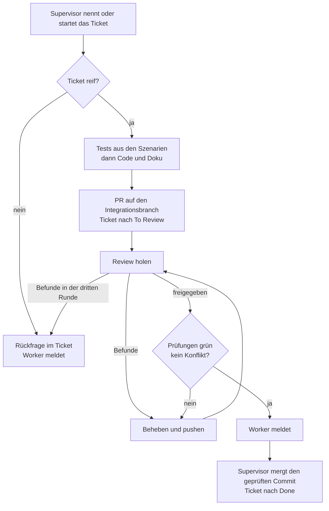

# Konzept

KI-Agents mit festen Rollen planen ein Projekt und arbeiten sein Board Ticket für Ticket ab. Der Mensch bestimmt Projekt und Features, beantwortet Rückfragen, gibt frei und nimmt Milestones ab.

Das Plugin beschreibt, was eine Rolle tut. Der [Runner](runner.md) bestimmt, wann und wo sie läuft, und stellt ihr Ereignisse zu. Mit Claude Code allein ist der Mensch der Runner.

## Bausteine

| Baustein | Aufgabe |
| --- | --- |
| Ticketsystem (Asana, Jira) | Hält Milestones, Tasks, Abhängigkeiten und Rückfragen. Trägt den Auftrag |
| Git und GitHub | Halten Code, Branches, Worktrees und PRs. Der PR trägt den Stand der Umsetzung: Urteile, Prüfungen, Freigabe |
| Dokumentation im Repository (`docs/`) | Roadmap, Konzepte und Featuredokumentation neben dem Code, im selben PR geändert und geprüft |
| Claude Code | Die umsetzende Kraft. Jede Rolle ist eine Sitzung von Claude Code |
| Plugin `ccmas` | Das Verhalten: die Abläufe der Rollen als Skills |
| Projektregeln (`CLAUDE.md` im Projekt) | Alles Projektspezifische: Referenzen auf Board und Repository, Prüfbefehle, Freigaben, der Maßstab für das Review, Grenzen. Legt `/ccmas:init` an |
| Verbindungen | Zugang der Sitzungen nach außen: zum Ticketsystem und zu GitHub |
| Runner | Führt die Sitzungen: starten, Worktree je Ticket, Ereignisse zustellen, mehrere nebeneinander. Im Minimum ist das Claude Code selbst, und der Mensch startet jede Sitzung von Hand |

## Grundsätze

- **Der Stand liegt außerhalb der Sitzungen.** Das Ticket trägt den Auftrag, der PR den Stand der Umsetzung, das Repository Code und `docs/`. Jede Sitzung darf enden; die nächste setzt aus diesem Stand fort.
- **Ein Ticket, eine Sitzung, ein PR.** Der Worker besitzt sein Ticket von To Do bis zum Merge, einschließlich Befunden, roten Prüfungen und Konflikten. Den Merge selbst gibt der Supervisor.
- **Rolle = Skill-Aufruf.** Eine Rolle ist eine Sitzung, deren erster Auftrag einen Skill aufruft. Derselbe Aufruf gilt mit jedem Runner.
- **Erst klären, dann bauen.** Vor dem ersten Code prüft der Worker, ob das Ticket reif ist. Fehlt etwas, das nur der Mensch klären kann, entsteht eine Rückfrage. Keine Annahmen.
- **Test zuerst, von klein nach groß.** Aus den Szenarien des Tasks entstehen zuerst die Tests. Ein Task ist eine isolierte Logik.
- **Wer umsetzt, prüft nicht.** Das Review läuft mit frischem Kontext und ändert nichts. Sein Urteil gilt für genau einen Commit.
- **Gemergt wird nur der geprüfte Commit.** Ändert sich der PR nach dem Urteil, braucht er ein neues.
- **Eine Stelle je Wissen.** Projektspezifisches steht in der `CLAUDE.md` des Projekts. Nur der Skill `ticket` kennt das Ticketsystem. Nur die Zuordnung des Runners kennt den Runner.
- **Nichts behaupten, was nicht geprüft ist.** Keine erfundenen Testergebnisse, Commits oder Links.

## Rollen

| Rolle | Aufruf | Aufgabe | Ergebnis |
| --- | --- | --- | --- |
| Mensch | | Projekt und Features bestimmen, mit dem Planner planen, Rückfragen beantworten, freigeben, Milestones abnehmen | Entscheidungen |
| Planner | `/ccmas:project-planning <Beschreibung>` `/ccmas:feature-planning <Milestone oder Beschreibung>` | Im Gespräch mit dem Menschen: ein Projekt in Milestones zerlegen; einen Milestone konzipieren und in Tasks zerlegen | Roadmap und Konzept unter `docs/`, Milestones und Tasks im Board |
| Supervisor | `/ccmas:supervisor [Milestone]` | Freigegebene PRs mergen, Tickets starten und fortsetzen, nennen, was auf den Menschen wartet, Milestones zur Abnahme bringen | Gemergte Tickets, gestartete oder genannte Schritte |
| Worker | `/ccmas:worker <Ticket>` | Reife prüfen, test-driven umsetzen, PR erstellen, Review holen, Befunde, rote Prüfungen und Konflikte beheben | Freigegebener PR |
| Reviewer | über den Runner, sonst `/ccmas:reviewer <Ticket>` | Den PR unabhängig prüfen | Urteil für einen Commit |

- Der Supervisor schreibt keinen Code und bewertet keinen PR. Der Worker mergt nicht. Der Reviewer ändert nichts.
- Eine Rückfrage an den Menschen darf jede Rolle stellen ([Rückfragen an den Menschen](board.md#rückfragen-an-den-menschen)).
- Modell und Rechte setzt der Start der Sitzung: ein starkes Modell für Planner, Supervisor und Reviewer, das Standardmodell für den Worker.

Die Abläufe der Rollen stehen in den Skills des Plugins. Sie sind die Norm; diese Spezifikation erzählt ihre Schritte nicht nach. Startbefehle und Skills: [README des Plugins](../../claude-plugin/README.md).

## Planung

| | Projekt planen | Milestone planen |
| --- | --- | --- |
| Skill | `project-planning` | `feature-planning` |
| Eingabe | Projektbeschreibung | Ein Milestone, oder die Beschreibung eines Features oder einzelnen Tickets |
| Frage | Was entsteht in welcher Reihenfolge? | Was genau soll entstehen und womit? |
| Ergebnis | `docs/roadmap.md`, Milestones im Backlog | `docs/milestones/<kurzname>.md`, Tasks in To Do |

Epic, Milestone und Feature bezeichnen dieselbe Ebene; diese Spezifikation sagt Milestone. Ein Task (auch Story) ist die Arbeit für genau einen Worker und ergibt einen PR.

- **Im Gespräch mit dem Menschen.** Ohne seine Freigabe entsteht nichts im Board.
- **Entscheidungen fließen nach unten.** Die Roadmap legt Grundentscheidungen fest, das Konzept Tech-Setup und Verhalten. Der Worker entscheidet nur, wie es in diesem Code umgesetzt wird.
- **Von klein nach groß.** Erst Grundlagen, dann einzelne Units, dann deren Zusammenführung.
- **Der Abnahmetest.** Der letzte Task eines Milestones prüft dessen Ergebnisziel und hält Befehle und Ausgaben im PR fest. Schlägt er fehl, behebt der Worker die Ursache im selben PR. Der Task wird erst gemergt, wenn der Test besteht; vorher geht der Milestone nicht zur Abnahme.
- **Rollierend.** Ausgeplant wird nur der Milestone, der als Nächstes dran ist.
- **Doku-PR ohne Sonderweg.** Der Planner schreibt in einem eigenen Worktree und öffnet einen PR, der nur `docs/` enthält. Nach dem Ja des Menschen in der Sitzung mergt er ihn und legt danach Milestones oder Tasks an. Ist der Mensch nicht da, pusht er den Entwurf, legt die Rückfrage `Freigabe: Konzept …` am Milestone an und legt sonst nichts an.
- **Wenn die Umsetzung das Konzept widerlegt:** Rückfrage am Task. Nach der Antwort zieht der Planner Konzept und offene Tasks nach.

## Ticket-Loop

### Worker

Der Ablauf steht im Skill [`worker`](../../claude-plugin/skills/worker/SKILL.md). Es gilt:

- **Reife vor Code.** Der Worker prüft, ob Ziel, Akzeptanzkriterien, betroffene Stellen, Vorgaben und Szenarien in diesem Code klar und erfüllbar sind. Bleibt etwas offen, entsteht eine Rückfrage, und er schreibt keinen Code.
- **Die Beschreibung des PR nennt, was zu prüfen ist:** Ticket, Änderung, Akzeptanzkriterien als Liste, welcher Test welches Szenario prüft, Prüfbefehle mit Ergebnis.
- **Drei Runden.** Nach Befunden in der dritten Review-Runde behebt der Worker nicht weiter. Er legt die Rückfrage `Entscheidung: Wie weiter mit <Ticket>` an.
- **Konflikte per Merge.** Der Worker arbeitet den Integrationsbranch per Merge in seinen Branch ein. Kein Rebase, kein `--force`. Danach braucht der PR ein neues Review, weil sich der Commit geändert hat.
- **Zwei Meldungen.** Der Worker meldet dem Supervisor nur eine Rückfrage und den PR, der freigegeben und grün ist. Bis zum Merge bleibt er für sein Ticket zuständig.

### Review

Der Maßstab gilt für jeden Reviewer, ob ihn der Runner stellt oder der Skill [`reviewer`](../../claude-plugin/skills/reviewer/SKILL.md). Er steht in Kurzform in der `CLAUDE.md` des Projekts, weil jeder Reviewer sie lädt. Was nur in der Beschreibung des PR steht, nimmt nicht jeder Reviewer als Vorgabe; die `CLAUDE.md` verweist ihn deshalb auf die Akzeptanzkriterien dort.

- Er prüft den PR gegen dessen Beschreibung: jedes Akzeptanzkriterium einzeln, zu jedem Szenario ein Test, technische Vorgaben eingehalten, nichts Fremdes im Diff, `docs/` passt zum Code.
- Er führt die Prüfbefehle selbst aus, soweit er kann.
- Pflicht-Befunde stehen am PR, je Befund mit Stelle, Fehler und woran die Behebung erkennbar ist. Hinweise ohne Pflicht stehen in der Zusammenfassung.
- Das Urteil lautet FREIGEGEBEN oder BEFUNDE und nennt den geprüften Commit.
- Trifft die Liste der [Freigaben](#freigaben) auf den Diff zu, setzt er `freigabe: nötig`. Er entfernt das Label nie.

### Merge

Der Supervisor mergt einen PR, wenn alles zutrifft:

1. Das Urteil FREIGEGEBEN gilt für genau den Commit, auf dem der PR steht.
2. Alle Prüfungen sind grün, und der PR hat keinen Konflikt.
3. Der PR trägt kein `freigabe: nötig`, oder die Freigabe ist erteilt (`freigabe: erteilt`).

Dann Squash in den Integrationsbranch, gebunden an den geprüften Commit. Ticket nach Done, schließen, Kommentar mit dem Merge-Commit. Sitzung, Worktree und Branch des Tickets werden aufgeräumt.

## Supervisor

Der Auftrag ist das ganze Board oder ein Milestone. Mehrere Supervisor im selben Projekt haben getrennte Milestones; ob mehrere möglich sind, bestimmt der Runner. Der Ablauf steht im Skill [`supervisor`](../../claude-plugin/skills/supervisor/SKILL.md). Eine Runde:

1. **Lesen.** Die offenen Tickets des Auftrags, die offenen PRs, die laufenden Sitzungen.
2. **Integrieren.** Jeden PR mergen, der die Bedingungen erfüllt. Integrieren geht vor Neuem.
3. **Fortsetzen.** Ein begonnenes Ticket, an dem etwas zu tun ist und niemand arbeitet: den Worker fortsetzen.
4. **Neues.** Startbare Tasks starten, höchstens drei Tickets gleichzeitig. Bei mehreren zuerst das, das die meisten anderen entsperrt, dann das im früheren Milestone, dann das ältere.
5. **Milestones.** Liegen alle Tasks in Done: `Freigabe: Milestone <Name> abnehmen` am Milestone anlegen, mit Ergebnisziel, Tasks, PRs und dem Ergebnis des Abnahmetests. Nach der Freigabe schließen. Ist kein Task startbar und hat der nächste Milestone keine Tasks: den Planner als nächsten Schritt nennen.
6. **Melden.** Nur, was sich geändert hat: geändert, zu starten, wartet auf dich, unklar.

Für ein Ticket läuft höchstens eine Sitzung. Der Supervisor ändert nichts, dessen Stand er nicht belegen kann. Den Stand von Review und Prüfungen überträgt er nicht ins Board; er steht am PR.

## Freigaben

- **Zwei Stufen.** Ein PR braucht eine Freigabe oder keine. Die `CLAUDE.md` des Projekts führt die Liste, wann sie nötig ist; Vorgabe: Datenmodell oder Migration, Berechtigungen, Zugangsdaten, CI oder Build, Dateien unter `.claude/`, die `CLAUDE.md`.
- **Wer entscheidet,** steht in der `CLAUDE.md`, getrennt für Rückfragen der Art `Entscheidung:`, für Merges mit Freigabe und für die Abnahme von Milestones: Mensch (Vorgabe) oder Supervisor.
- **Entscheidet der Supervisor,** hält er Entscheidung und Begründung im Ticket fest und setzt `freigabe: erteilt` selbst. Eine Abnahme erteilt er nur, wenn das Ergebnis des Abnahmetests vorliegt.
- **Nie übertragen:** Läufe gegen Systeme außerhalb der lokalen Umgebung, alles nach `main`, Zugangsdaten, `Zuarbeit:`-Rückfragen und Änderungen am Abschnitt „Freigaben“ der `CLAUDE.md`.
