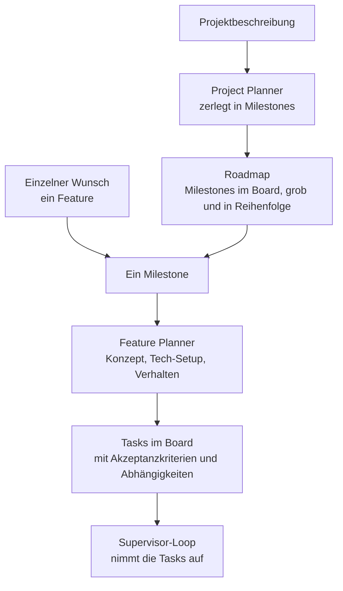

# Planung

> Stand 2026-11-16: im Plugin 0.3.0 umgesetzt. Offen ist der Punkt unter „Offen in der Planung“.

Die Planung beantwortet, wie aus einem Wunsch Tickets werden, die sich ein Agent nehmen kann. Sie liegt vor dem [Supervisor-Loop](ablauf.md#supervisor-loop) und läuft im Gespräch mit dem Menschen.

## Ebenen

| Ebene | Andere Namen | Was es ist | Wer legt es an |
| --- | --- | --- | --- |
| Projekt | | Die Projektbeschreibung: Ziel, Umfang, Rahmen | Mensch |
| Milestone | Epic, Feature | Ein prüfbares Zwischenergebnis, das für sich einen Nutzen hat | Project Planner, oder der Mensch direkt |
| Task | Story | Arbeit für genau einen Worker-Lauf, ein PR | Feature Planner |
| Subtask | | Eine Rückfrage an den Menschen, sonst nichts | Jede Rolle |

Epic, Milestone und Feature bezeichnen dieselbe Ebene. Diese Spezifikation sagt Milestone.

## Drei Stufen

| | Project Planner | Feature Planner | Ticket-Planung |
| --- | --- | --- | --- |
| Eingabe | Projektbeschreibung | Ein Milestone als Parameter, oder die Beschreibung eines Features | Ein Task |
| Frage | Was entsteht in welcher Reihenfolge? | Was genau soll entstehen und womit? | Wie wird das in diesem Code umgesetzt? |
| Ergebnis | Roadmap: Milestones mit Ergebnisziel | Konzept des Milestones und seine Tasks | Plan mit betroffenen Dateien und Schritten |
| Tiefe | Grob | Verhalten und Technik festgeschrieben, Umsetzung offen | Umsetzung |
| Arbeitsweise | Im Gespräch mit dem Menschen, mit Recherche im Netz | Im Gespräch mit dem Menschen, mit Recherche im Netz, liest den Code | Allein, liest Ticket und Code |
| Wie oft | Einmal je Projekt, danach bei Kurswechsel | Einmal je Milestone, kurz bevor er dran ist | Einmal je Task |

**Entscheidungen fließen nur nach unten.** Jede Stufe arbeitet mit dem, was die Stufe darüber festgelegt hat, und trifft keine Entscheidung, die dorthin gehört. Fehlt eine, ist das eine Rückfrage, keine Annahme.

## Project Planner

Er nimmt eine Projektbeschreibung und macht daraus eine Roadmap.

- **Klären.** Ziel, Nicht-Ziele und Rahmen des Projekts, im Gespräch mit dem Menschen.
- **Grundentscheidungen festhalten.** Was für das ganze Projekt gilt: Tech-Stack, grobe Architektur, Betrieb. Wo nötig, recherchiert er dafür im Netz.
- **In Milestones zerlegen.** Jeder Milestone bekommt:
  - ein **Ergebnisziel**, das sich prüfen lässt („Ein Nutzer kann sich anmelden“, nicht „Anmeldung bauen“),
  - **Umfang** und **Nicht-Umfang** in wenigen Sätzen,
  - eine **Einordnung**: Art (Grundlage, Unit, Zusammenführung), Größe (klein, mittel, groß) und Unsicherheit (bekannt, zu klären),
  - seine **Abhängigkeiten** zu anderen Milestones.
- **Von klein nach groß ordnen.** Zuerst die Grundlagen, dann die einzelnen Units, jede für sich lauffähig und geprüft. Danach werden die Units Stück für Stück zu einer funktionierenden Software zusammengesetzt. Kein Milestone setzt etwas zusammen, das nicht vorher als Unit steht. Innerhalb dieser Ordnung kommt Unsicheres früh, und was nebeneinander laufen kann, wird als paralleler Weg gekennzeichnet.
- **Nicht tiefer gehen.** Er legt keine Tasks an und plant keinen Milestone aus.

Ergebnis: die Roadmap unter `docs/` und je Milestone ein Ticket im Board mit Abhängigkeiten. Der Mensch gibt die Roadmap frei.

Für ein einzelnes Feature in einem bestehenden Projekt entfällt diese Stufe. Der Mensch gibt die Beschreibung direkt dem Feature Planner.

## Feature Planner

Er plant genau einen Milestone aus. Der Milestone kommt als Parameter. Der Mensch nutzt ihn, um einen Milestone zu konzipieren.

- **Verstehen.** Er liest den Milestone, die Roadmap, die Dokumentation und den vorhandenen Code.
- **Recherchieren.** Er prüft im Netz, was es für die Aufgabe gibt und was aktuell ist: Bibliotheken, Versionen, bekannte Grenzen. Das Konzept muss realistisch sein, also zum vorhandenen Code und zum Stand der Technik passen.
- **Konzept schreiben.** Es legt fest, was gewünscht ist, nicht wie es umgesetzt wird:
  - **Gewünschtes Verhalten:** Was das System danach kann, aus Sicht dessen, der es benutzt. Schnittstellen, Daten, Fehlerfälle.
  - **Tech-Setup:** Stack, Bibliotheken mit Version, Konfiguration, Dienste.
  - **High-Level-Konzept:** Die Bausteine und wie sie zusammenspielen.
  - **Nicht-Ziele** und **Entscheidungen** mit Begründung und Quelle.
- **In Tasks zerlegen.** Klein, logisch, aufeinander aufbauend:
  - Ein Task ist eine isolierte Logik: ein abgegrenztes Stück mit klarer Schnittstelle, das sich ohne den Rest prüfen lässt.
  - Ein Task ist die Arbeit eines Worker-Laufs und ergibt einen PR.
  - Jeder Task ist für sich prüfbar und lässt den Integrationsbranch lauffähig.
  - Die Reihenfolge steht in den Abhängigkeiten. Was unabhängig ist, bleibt unabhängig, damit es parallel laufen kann.
- **Tasks anlegen.** Jeder Task enthält Ziel, gewünschtes Verhalten, die technischen Vorgaben aus dem Konzept, die bekannten Szenarien, Akzeptanzkriterien, Typ, Meilenstein und eine vorläufige Risikoklasse.

Ergebnis: das Konzept des Milestones unter `docs/` und seine Tasks im Board. Der Mensch gibt beides frei; danach gilt der Milestone als ausgeplant.

- **Die Akzeptanzkriterien schreibt der Feature Planner,** nicht die Rolle, die später umsetzt. So prüft der Reviewer gegen einen Maßstab, den der Geprüfte nicht selbst gesetzt hat.
- **Die technischen Details stehen fest, bevor ein Worker beginnt.** Der Worker arbeitet nicht aus, welcher Stack oder welches Verhalten gewünscht ist. Er liest es im Task.
- **Entwickelt wird test-driven.** Der Feature Planner schreibt die bekannten Szenarien in den Task: Eingabe, erwartetes Ergebnis, Fehlerfälle. Der Worker macht daraus zuerst die Tests und schreibt danach den Code, der sie erfüllt. So sind die bekannten Fälle von Anfang an abgeprüft.
- **Geplant wird rollierend.** Ausgeplant wird nur der Milestone, der als Nächstes dran ist. Spätere ändern sich durch das, was vorher gebaut wird.

## Wo die Ergebnisse liegen

| Ergebnis | Ort |
| --- | --- |
| Roadmap | `docs/`, als Doku-PR |
| Konzept eines Milestones | `docs/`, als Doku-PR |
| Milestone | Im Board in der Ticketart, die das Ticketsystem dafür hat: in Asana ein Meilenstein, in Jira ein Epic |
| Task | Ticket im Board, dem Milestone zugeordnet |

- **Doku-PR wie jeder andere.** Project Planner und Feature Planner schreiben in einem eigenen Worktree auf einem eigenen Branch und öffnen einen PR auf den Integrationsbranch. Er läuft durch Review und Merge wie ein PR mit Code. Im Hauptverzeichnis ändern sie nichts.
- **Der Doku-PR hat ein eigenes Ticket.** `Roadmap dokumentieren` oder `Konzept <Milestone> dokumentieren`: Typ Concept, Risikoklasse R0, mit Akzeptanzkriterien, angelegt in To Review mit „Am Zug“ Reviewer. So gilt für ihn die Kette unverändert. Die ersten Tasks hängen von diesem Ticket ab; kein Worker beginnt, bevor das Konzept im Integrationsbranch liegt. Ebenso hängen die ersten Milestones vom Ticket der Roadmap ab.
- **Roadmap:** `docs/roadmap.md`. **Konzept:** `docs/milestones/<kurzname>.md`. Der Milestone im Board trägt das Konzept in Kurzform und den Pfad.
- **Task und Milestone** hängen über das Feld Meilenstein zusammen. Abhängigkeiten gibt es zwischen Milestones und zwischen Tasks.
- **Die Ticketart kennt nur der Skill `ticket`.** Alle anderen Skills sprechen von Milestone und Task.

## Supervisor und Milestones

- Der Supervisor plant keinen Milestone selbst aus. Hat der nächste Milestone keine Tasks und ist sonst nichts startbar, oder bittet ihn der Mensch darum, nennt er als nächsten Schritt den Feature Planner mit diesem Milestone. Der nächste Milestone ist der offene ohne offene Abhängigkeit, der in der Roadmap am weitesten vorn steht.
- **Abschluss:** Sind alle Tasks eines Milestones in Done, legt der Supervisor am Milestone eine Rückfrage `Freigabe: Milestone <Name> abnehmen` an, mit Ergebnisziel und der Liste der Tasks und PRs. Nach der Freigabe verschiebt er den Milestone nach Done und schließt ihn.
- Ein Milestone durchläuft die Spalten nicht und bekommt nie den Schritt Planner, Worker, Reviewer oder Merger.

## Offen in der Planung

- **Planner und Worker (zurückgestellt, wird später geprüft):** Mit dem Feature Planner bleibt für die Ticket-Planung nur das Abbilden auf den Code. Zur Wahl steht, sie in den Worker zu legen: Start im Plan-Modus auf Opus, Umsetzung auf Sonnet (`--model opusplan --permission-mode plan`). Bis zur Entscheidung gelten [Rollen](rollen.md#rollen) und [Ticket-Loop](ablauf.md#ticket-loop) unverändert mit eigenem Planner.
