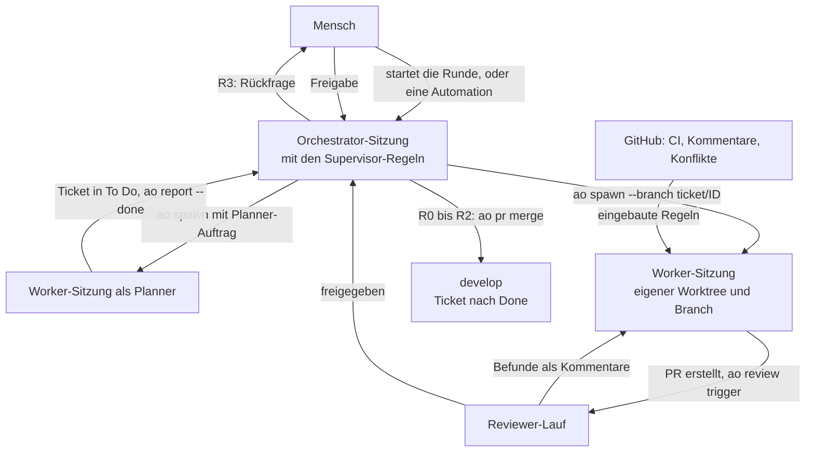

# CCMAS mit Orchestrator

Wie Orchestrator (kurz AO) als Läufer für CCMAS dient: Das Verhalten kommt aus dem Plugin `ccmas`, Orchestrator führt die Sitzungen ([Läufer](../01-spezifikation/konzept.md#bausteine)).

**Stand:** Ausgearbeitet am 14.11.2026 allein aus der Dokumentation von Orchestrator ([Quellen](#quellen)), am 15.11.2026 auf das Plugin umgestellt. Installiert und ausprobiert ist nichts. Befehle und Schlüssel sind der Dokumentation entnommen; vor dem Einsatz mit `ao <befehl> --help` gegen die installierte Fassung prüfen. Was die Dokumentation offen lässt, steht unter [Offene Punkte](#offene-punkte).

## Kurzfassung

- Orchestrator übernimmt, was ein Läufer leisten soll: Sitzungen starten, je Sitzung ein Worktree mit Branch, Sitzung im Terminal oder im Chat bedienen, PR, CI und Reviews beobachten, mehrere Sitzungen nebeneinander.
- Das Verhalten bleibt im Plugin `ccmas` ([Das Plugin](../../claude-plugin/README.md)). Orchestrator startet Claude Code im Worktree; dazu kommen zwei Regeldateien je Projekt, eine für Worker, eine für den Orchestrator.
- Orchestrator kennt drei Rollen, CCMAS fünf. Supervisor und Merger fallen in der Orchestrator-Sitzung zusammen, Planner und Worker sind Worker-Sitzungen mit verschiedenem Auftrag, der Reviewer ist ein eigener Reviewer-Lauf.
- Zwei Dinge leistet Orchestrator nicht: Es kennt Asana nicht, und es integriert nie von selbst. Das Ticket pflegen weiter die Skills über die Asana-Verbindung von Claude Code, und den Merge löst eine Sitzung oder der Mensch ausdrücklich aus.
- Zu tun bleibt: das Plugin global aktivieren, das Projekt einrichten und zwei Regeldateien schreiben.

## Die Konzepte, die das möglich machen

| Konzept | Was es ist | Wofür in CCMAS |
| --- | --- | --- |
| Daemon, Desktop-App, `ao` | Ein lokaler Dienst hält Projekte, Sitzungen und PR-Stand in einer Datenbank unter `~/.ao`. Die Desktop-App ist die Oberfläche, `ao` ein Client desselben Dienstes | Der Läufer |
| Projekt | Ein registriertes lokales Repository mit eigenen Einstellungen | Das Zielprojekt |
| Sitzung | Die Arbeitseinheit: ein Agent an einer Aufgabe, mit dauerhafter Kennung, eigenem Verlauf und eigenem Arbeitsverzeichnis | Ein Rollenlauf |
| Worktree je Sitzung | Jede Sitzung in einem Git-Projekt bekommt einen eigenen Worktree und Branch. Sitzungen teilen sich weder Dateien noch Terminal noch Verlauf | Der Worktree des Tickets |
| Harness | Das Agenten-Programm, hier Claude Code. Orchestrator nutzt das installierte Programm und dessen Anmeldung | Claude Code mit dem Abo-Login |
| Rollen | Worker setzt um und besitzt PRs. Orchestrator überblickt ein Projekt und delegiert. Reviewer prüft den PR eines Workers | [Rollen abbilden](#rollen-abbilden) |
| Chat und Terminal | Zwei Arten, eine Sitzung zu bedienen. Im Terminal läuft die gewohnte Oberfläche von Claude Code. Eine Sitzung lässt sich umschalten | Der Mensch kann in jeder Sitzung mitarbeiten |
| Projektregeln | Dauerhafte Anweisungen je Rolle, als Text oder als Datei im Repository. Sie werden beim Start der Sitzung an die Anweisungen der Rolle angehängt | Regeln für Worker und Orchestrator, zusätzlich zum Plugin |
| PR-Beobachtung | Orchestrator verfolgt PRs der Sitzungen: Prüfungen, Review-Stand, offene Kommentare, Integrierbarkeit | Prüft Übergaben am PR nach |
| Eingebaute Reaktionen | Rote Prüfungen, verlangte Änderungen, offene Kommentare und Konflikte gehen von selbst an die Sitzung, der der PR gehört. Unverändertes wird nicht doppelt gesendet | Deckt einen Teil der [Merge-Phase](../01-spezifikation/ablauf.md#merge-phase) ab |
| Reviewer-Lauf | Ein eigener Agent prüft den PR eines Workers. Nötige Änderungen gehen als Kommentare an den Worker zurück | Der Reviewer |
| Meldungen der Worker | Ein Worker meldet seinem Orchestrator den Stand: Zwischenstand, braucht Eingabe, steckt fest, fertig | Entspricht dem Feld „Ausgang“ |
| Benachrichtigungen | Dauerhafte Liste: Sitzung wartet auf Eingabe, PR bereit zum Merge, PR gemergt, PR geschlossen | „Wartet auf dich“ |
| Cues | Gespeicherte Aufträge oder Shell-Befehle je Projekt, von Hand ausgelöst | Die Rollenaufträge als Knopf |
| Automationen | Geplante Aufträge nach Zeitplan, mit Projekt, Auftrag, Agent und Rolle | Eine Supervisor-Runde nach Uhr |

## Was Orchestrator übernimmt

| Aufgabe | Mit Orchestrator | Lücke |
| --- | --- | --- |
| Rolle starten | `ao spawn` oder „New task“ in der App | keine |
| Worktree und Branch je Ticket | Legt jede Sitzung selbst an; Branch mit `--branch` wählbar | Ort und Name bestimmt Orchestrator ([Was nicht passt](#was-nicht-passt)) |
| Sitzung bedienen | Terminal-Ansicht der Sitzung in der App | keine |
| Projekt einrichten | Kein Gegenstück | Das macht `/ccmas:init` aus dem Plugin |
| Läufe verfolgen | Sitzungsübersicht, `ao session ls`, Zustände aus Aktivität und PR-Stand | keine |
| Ergebnis nachprüfen | PR-Beobachtung liefert Prüfungen, Review und Integrierbarkeit | Die Spalte im Board prüft niemand |
| Supervisor-Loop | Orchestrator-Sitzung, die Worker startet und überwacht | Läuft als eine lange Sitzung, nicht als frische Runden |
| Parallelität | Mehrere Sitzungen nebeneinander | Eine Obergrenze nennt die Dokumentation nicht |
| Meldung am Ende eines Schritts | `ao report` mit festen Zuständen | Kein frei wählbares Format je Rolle |
| Szenario-Tests | Kein Gegenstück | bleibt offen |

## Rollen abbilden

| CCMAS-Rolle | In Orchestrator | Start | Verhalten kommt aus |
| --- | --- | --- | --- |
| Supervisor | Orchestrator-Sitzung | `ao spawn --kind orchestrator` oder in der App | Regeldatei des Orchestrators, Skill `ccmas:supervisor` |
| Planner | Worker-Sitzung mit Planner-Auftrag | `ao spawn --kind worker` mit dem Auftrag als Text | Skill `ccmas:task-planning` |
| Worker | Worker-Sitzung | `ao spawn --kind worker --branch ticket/<Ticket>` | Regeldatei der Worker, Skill `ccmas:feature-parallel` |
| Reviewer | Reviewer-Lauf am PR des Workers | `ao review trigger`, oder der Worker fordert ihn selbst an | Reviewer-Einstellung des Projekts |
| Merger | Kein eigener Agent. Fertigmachen übernehmen die eingebauten Reaktionen im Worker, den Merge löst die Orchestrator-Sitzung oder der Mensch aus | `ao pr merge` | Regeldatei des Orchestrators, Skill `ccmas:merge` |

- **Modell je Rolle:** Ein Projekt hat je einen Agenten mit Modell für Worker und für den Orchestrator. Der Planner soll ein stärkeres Modell bekommen als der Worker; das geht je Start mit `--model`. Für den Reviewer nimmt `ao review trigger` ein eigenes Modell an.
- **Rechte:** Die Einstellung `permissions` mit dem Wert `bypass-permissions` entspricht den maximalen Rechten aus [Rechte](../01-spezifikation/claude-code.md). Reviewer erben die Rechte der Worker nicht.
- **Kein Agent beim Start:** Dass sich beim Start einer Sitzung ein Agent des Plugins wählen lässt, steht nicht in der Dokumentation. Die Rolle steckt deshalb im ersten Auftrag, der den Skill aufruft, und in den Regeldateien.

## Wo das Verhalten liegt

Die Aufteilung aus [Wie Claude Verhalten lernt](../01-spezifikation/claude-code.md#wie-claude-verhalten-lernt) bleibt. Es kommt eine Ebene dazu.

| Ebene                        | Inhalt                                                                                  | Ort                                                                                                                  |
| ---------------------------- | --------------------------------------------------------------------------------------- | -------------------------------------------------------------------------------------------------------------------- |
| Fähigkeiten und Rollen       | Die Skills und Agents                                                                   | Plugin `ccmas`, global oder im Projekt aktiviert                                                                     |
| Projektregeln für alle       | Referenzen auf Board und Felder, Prüfbefehle, Grenzen                                   | `CLAUDE.md` im Repository, angelegt von `/ccmas:init`                                                                |
| Regeln je Orchestrator-Rolle | Was ein Worker immer beachtet; wie der Orchestrator überwacht, delegiert und integriert | Zwei Dateien im Repository, in den Projekteinstellungen als `agentRulesFile` und `orchestratorRulesFile` eingetragen |
| Auftrag                      | Welcher Skill mit welchem Ticket                                                        | Der erste Auftrag beim Start, als Text oder als Cue                                                                  |

- **Das Plugin muss an sein.** Orchestrator startet Claude Code selbst. Damit die Sitzungen das Plugin laden, wird es global aktiviert oder im Projekt ([Das Plugin](../../claude-plugin/README.md)).
- **Projektregeln und Regeldateien müssen in Git liegen.** Eine Sitzung arbeitet im Worktree und sieht nur, was committet ist.
- **Regeldateien werden beim Start gelesen.** Eine Änderung wirkt erst in neuen Sitzungen. Der Pfad ist relativ zum Repository und darf es nicht verlassen.
- **Die Agents des Plugins sind die Quelle der Regeldateien.** Supervisor und Merger für den Orchestrator, Worker für die Worker. Planner und Reviewer stehen in ihrem Auftrag beziehungsweise in ihrem Skill.

## Ablauf eines Tickets



1. **Supervisor.** Die Orchestrator-Sitzung liest das Board nach `ccmas:supervisor` und bestimmt das nächste Ticket. Anders als im [Minimum](../01-spezifikation/claude-code.md) kann sie den nächsten Schritt selbst starten, statt nur den Befehl zu nennen.
2. **Planner.** Eine Worker-Sitzung mit dem Auftrag, das Ticket auszuplanen. Sie schreibt Plan, Akzeptanzkriterien und Risikoklasse ins Ticket, verschiebt es nach To Do und meldet sich mit `ao report --done` ab. Ihren Worktree braucht sie nicht.
3. **Worker.** Eine Worker-Sitzung auf dem Branch `ticket/<Ticket>`. Sie setzt um, pusht und erstellt den PR. Der PR gehört damit dieser Sitzung.
4. **Reviewer.** Ist `workersRequestReview` eingeschaltet, fordert der Worker den Reviewer selbst an, sobald der PR steht, und erneut nach jeder Korrektur. Nötige Änderungen kommen als Kommentare zurück in die Worker-Sitzung. Eine Freigabe erzeugt keinen Kommentar; den Stand zeigt `ao review ls`.
5. **Fertig machen.** Schlägt eine Prüfung fehl oder entsteht ein Konflikt, bekommt die Worker-Sitzung das von selbst gemeldet und behebt es. Diesen Teil des Mergers braucht es nicht mehr.
6. **Merge.** Sind Prüfungen grün und der Reviewer hat freigegeben, entsteht die Benachrichtigung „bereit zum Merge“. Integriert wird nie von selbst. Bei R0 bis R2 löst die Orchestrator-Sitzung `ao pr merge` aus, bei R3 erst nach deiner Freigabe. Der Befehl verlangt den Commit, auf dem der PR stehen muss; das ist der „geprüfte Commit“ aus dem Urteil.
7. **Abschluss.** Die Sitzung, die integriert hat, verschiebt das Ticket nach Done.

## Einrichtung

### 1 Installieren und prüfen

- Die Desktop-App installieren (macOS, auch über Homebrew). Sie bringt den Dienst und `ao` mit.
- Voraussetzungen: Git, die Kommandozeile `gh` angemeldet, Claude Code installiert und angemeldet.
- Prüfen:

```bash
ao doctor
ao agent ls --refresh
```

### 2 Projekt registrieren

```bash
ao project add --path /Users/alex/Projekte/alexwenzel/ccmas --id ccmas \
  --worker-agent claude-code --orchestrator-agent claude-code
ao project get ccmas
```

`ao start` öffnet nur die App und registriert nichts.

### 3 Plugin aktivieren und Projekt einrichten

- Das Plugin global aktivieren. Die Befehle stehen in der `README.md` des Code-Repositorys:

```bash
claude plugin marketplace add /Users/alex/Projekte/alexwenzel/ccmas
claude plugin install ccmas@alexwenzel --scope user
```

- Im Zielprojekt `/ccmas:init` ausführen. Es legt `CLAUDE.md` und `docs/` an und trägt die Referenzen ein.
- Die zwei Regeldateien liegen im Code-Repository von CCMAS unter `orchestrator/`: `agent-rules.md` für Worker-Sitzungen, `orchestrator-rules.md` für die Orchestrator-Sitzung. Für ein anderes Projekt werden sie in dessen Repository kopiert.
- Alles committen.

### 4 Projekt einstellen

In der App unter Project Settings, je Rolle:

| Einstellung | Wert |
| --- | --- |
| Basis-Branch (`defaultBranch`) | `develop` |
| Worker: Agent, Modell, Rechte | Claude Code, das schwächere Modell, `bypass-permissions` |
| Orchestrator: Agent, Modell, Rechte | Claude Code, das starke Modell, `bypass-permissions` |
| Regeln der Worker (`agentRulesFile`) | Pfad der Worker-Regeldatei |
| Regeln des Orchestrators (`orchestratorRulesFile`) | Pfad der Orchestrator-Regeldatei |
| Reviewer (`reviewers`) | Claude Code |
| Worker fordern Review an (`workersRequestReview`) | ein |
| Standard-Oberfläche (Settings → General) | Terminal UI, wenn du die gewohnte Claude-Oberfläche willst |

Über die Kommandozeile geht dasselbe mit `ao project set-config`. Vorsicht bei `--config-json`: Es ersetzt die gesamte Projekteinstellung, und ein Tippfehler in einem Schlüssel löscht still, was dort stand. Vorher mit `ao project get ccmas --json` ansehen und lieber die einzelnen Schalter aus `ao project set-config --help` nehmen.

### 5 Rollen starten

```bash
# Supervisor
ao spawn --project ccmas --kind orchestrator --name "Supervisor" --mode tui

# Planner für ein Ticket oder eine Beschreibung
ao spawn --project ccmas --kind worker --name "CC-12 Planner" --mode tui \
  --model <starkes Modell> --prompt "/ccmas:task-planning CC-12"

# Worker
ao spawn --project ccmas --kind worker --name "CC-12" --mode tui \
  --branch ticket/CC-12 --prompt "/ccmas:feature-parallel CC-12"

# Reviewer am PR des Workers
ao review trigger <Sitzung des Workers> --agent claude-code --model <starkes Modell>
ao review ls <Sitzung des Workers>

# Merge
ao pr merge <PR-Nummer> --url <PR-URL> --expected-head-sha <geprüfter Commit>
```

Dieselben Aufträge lassen sich als Cues speichern und in der App auslösen:

```bash
ao cue create --project ccmas --name "Planner" --prompt "/ccmas:task-planning <Ticket>"
```

### 6 Betrieb

```bash
ao session ls --project ccmas
ao send --session <Sitzung> --message "…"
ao session cleanup --dry-run
```

- Was auf dich wartet, steht in der Benachrichtigungsliste der App.
- Eine Automation kann die Supervisor-Runde nach Zeitplan starten. Sie läuft im lokalen Dienst: Der Rechner muss wach sein und die App laufen.

## Regeldateien

Die beiden Regeldateien sind geschrieben und liegen im Code-Repository unter `orchestrator/`, zusammen mit einer Anleitung zur Einrichtung. Erprobt sind sie noch nicht.

| Datei | Feld | Inhalt |
| --- | --- | --- |
| `orchestrator/agent-rules.md` | `agentRulesFile` | Die Rolle ergibt sich aus dem ersten Auftrag (Planner oder Worker). Ticket nur über den Skill pflegen, im Worktree von Orchestrator bleiben, PR mit `gh`, Review anfordern, nie selbst integrieren, nach jedem Schritt mit `ao report` melden |
| `orchestrator/orchestrator-rules.md` | `orchestratorRulesFile` | Supervisor und Integrieren in einer Sitzung: Board lesen, Schritte mit `ao spawn` starten, das Urteil des Reviewer-Laufs ins Ticket eintragen, R0 bis R2 mit `ao pr merge` integrieren, bei R3 auf die Freigabe warten |

Zwei Festlegungen stecken darin:

- **Review über Orchestrator.** Die Prüfung macht der Reviewer-Lauf von Orchestrator, nicht der Skill `ccmas:code-review`. Eine eigene Reviewer-Sitzung bekäme einen eigenen Worktree und stünde nicht auf dem Stand des PR. Das Urteil trägt die Orchestrator-Sitzung ins Ticket ein und zählt die Runden.
- **Kein eigener Merger.** Konflikte und fehlgeschlagene Prüfungen meldet Orchestrator an den Worker. Den Merge löst die Orchestrator-Sitzung aus, mit dem geprüften Commit als Bedingung.

Am Plugin selbst war dafür nichts zu ändern.

## Was nicht passt

- **Asana ist kein Tracker.** Orchestrator liest Issues nur aus GitHub und GitLab und schreibt nie zurück. Das Board bleibt Sache der Skills über die Asana-Verbindung von Claude Code. Orchestrator sieht deshalb weder Spalte noch Felder; „Am Zug“ und „Ausgang“ kennt nur das Ticket.
- **Der Supervisor wird eine lange Sitzung.** Die Orchestrator-Sitzung überwacht dauerhaft. Das widerspricht dem Grundsatz kurzer, frischer Sitzungen und kostet Kontext. Ausweg: die Orchestrator-Sitzung je Runde neu starten oder die Runde als Automation laufen lassen.
- **Kein Merge ohne Auslöser.** Eine Einstellung für selbsttätiges Integrieren gibt es nicht. Für R0 bis R2 muss die Orchestrator-Sitzung den Befehl geben.
- **Das Urteil des Reviewers landet nicht im Ticket.** Der Reviewer-Lauf hält sein Urteil in Orchestrator fest. Die Felder Review-Runde und das Urteil im Ticket muss eine andere Sitzung nachtragen. Eine Grenze von drei Runden kennt Orchestrator nicht.
- **Eine Freigabe in Orchestrator ist keine Freigabe auf GitHub.** Verlangt der Branch-Schutz eine Freigabe, reicht der Reviewer-Lauf nicht.
- **Worktrees liegen woanders.** Unter `~/.ao/data/worktrees`, nicht im Projekt. Ohne `--branch` heißt der Branch `ao/<Sitzung>/root`.
- **Der Planner bekommt einen Worktree, den er nicht braucht.** Jede Worker-Sitzung in einem Git-Projekt legt einen an.
- **Nutzungsdaten.** Die App sendet in der Auslieferung Nutzungsdaten an einen Analysedienst, darunter den GitHub-Benutzernamen. Abschaltbar unter Settings → General → Privacy.

## Bewertung

| | Claude Code direkt | Orchestrator |
| --- | --- | --- |
| Einrichtung | Plugin aktivieren, Projekt einrichten | Zusätzlich installieren, Projekt registrieren, Regeldateien schreiben |
| Fünf Rollen mit eigenem Agent | Ja | Drei Rollen; Planner und Merger sind Aufträge, keine Rollen |
| Parallelität, Überblick, Rückmeldung aus CI | Von Hand, in mehreren Terminals | Vorhanden |
| Frische Sitzung je Schritt | Ja | Für Worker ja, für den Supervisor nur mit Umweg |
| Ticketsystem im Ablauf | Über die Skills | Über die Skills; Orchestrator selbst sieht das Board nicht |
| Bedienung | Terminal | Desktop-App, Kommandozeile zusätzlich |
| Abhängigkeit | Nur Claude Code | Eine weitere App, die sich ändert; Open Source unter Apache-2.0 |

Orchestrator ersetzt den Läufer, nicht das Konzept. Rollen, Board, Risikoklassen und Übergaben aus [Spezifikation](../01-spezifikation/README.md) bleiben, und sie stehen weiter im Plugin. Der Gewinn liegt bei mehreren Tickets gleichzeitig und bei der Rückmeldung aus PR und CI; für ein einzelnes Ticket reicht Claude Code direkt.

## Offene Punkte

Die Dokumentation beantwortet diese Fragen nicht. Sie sind beim ersten Versuch zu klären:

1. **Lädt eine Sitzung Plugin und Projektregeln?** Im Terminal läuft Claude Code im Worktree; dann sollte es das aktivierte Plugin und die `CLAUDE.md` wie gewohnt laden. Für die Chat-Ansicht und für Reviewer-Läufe ist das nicht belegt.
2. **Skill-Aufruf im ersten Auftrag:** Ob `--prompt "/ccmas:… <Ticket>"` den Skill aufruft, ist ungeprüft.
3. **Wie startet der Orchestrator Worker?** Die Dokumentation sagt, dass er es kann, und nennt `ao spawn`, `ao send`, `ao review trigger` und die Meldungen der Worker. Den genauen Weg der Meldungen in die Orchestrator-Sitzung beschreibt sie nicht.
4. **Reviewer mit eigenen Regeln:** Ob ein Reviewer-Lauf die Prüfschritte aus `ccmas:code-review` übernimmt oder nach eigenem Muster prüft.
5. **Merge-Art:** Ob `ao pr merge` einen Squash-Merge macht, steht nicht in der Dokumentation.
6. **Asana in der Sitzung:** Ob die Asana-Verbindung in von Orchestrator gestarteten Sitzungen verfügbar ist. Für Läufe ohne Oberfläche ist das Lesen nachgewiesen ([Nachgewiesen](../01-spezifikation/offene-punkte.md)).

## Quellen

- [Guides, Übersicht](https://docs.orchestrator.inc/guides/)
- [Per-role agents](https://docs.orchestrator.inc/guides/per-role-agents/)
- [Parallel work](https://docs.orchestrator.inc/guides/parallel-issues/)
- [Review loop](https://docs.orchestrator.inc/guides/review-loop/)
- [CI recovery](https://docs.orchestrator.inc/guides/ci-recovery/)
- [Handle CI and review feedback](https://docs.orchestrator.inc/guides/reactions/)
- [Forking sessions](https://docs.orchestrator.inc/guides/session-forks/)
- [Import existing sessions](https://docs.orchestrator.inc/guides/import-sessions/)
- [Multi-project](https://docs.orchestrator.inc/guides/multi-project/)
- [Cloud sessions](https://docs.orchestrator.inc/guides/cloud/)
- [Move from Conductor](https://docs.orchestrator.inc/guides/migrate-from-conductor/)
- [CLI reference](https://docs.orchestrator.inc/cli/)
- [Configuration](https://docs.orchestrator.inc/configuration/), [Projects](https://docs.orchestrator.inc/configuration/projects/), [Automation reference](https://docs.orchestrator.inc/configuration/lifecycle-automation/)
- [Architecture](https://docs.orchestrator.inc/architecture/)
- [Agents](https://docs.orchestrator.inc/plugins/agents/), [Claude Code](https://docs.orchestrator.inc/plugins/agents/claude-code/), [Trackers](https://docs.orchestrator.inc/plugins/trackers/)
- [Installation](https://docs.orchestrator.inc/installation/), [FAQ](https://docs.orchestrator.inc/faq/)

## Einrichtung im Repository

Die beiden Regeldateien liegen unter [`orchestrator/`](../../orchestrator/). Wie sie eingetragen werden, steht in [einrichtung.md](einrichtung.md).
